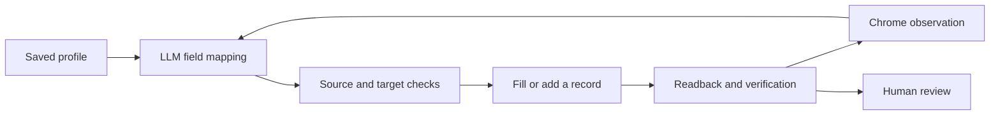

<div align="center">

# Resume Autofill

**Less copy and paste. More room for your next step.**

A resume form assistant for the Chrome you already use.

[简体中文](README.md) · [English](README.en.md)


[Quick start](#quick-start) · [Everyday use](#using-it) · [FAQ](#faq) · [Authors](#authors) · [Autonomous agent](https://github.com/SprayWaterXCW/resume-agent-lab)

</div>

<picture>
  <source media="(prefers-color-scheme: dark)" srcset="docs/assets/hero-dark.svg">
  
</picture>

## 👋 Another resume form?

Your profile says “university,” the website asks for “graduation school,” and two education records have to fit into one initial card. Small differences turn a familiar application form into another evening of typing.

Resume Autofill helps with that repetitive work. Save your profile once, open a recruitment form, and click **“开始填写此标签页” — Start filling this tab**. The assistant tries to understand field meanings, add missing experience cards, and show what happened so you can review it.

**Available as a Chrome extension with a local service, installed from source.** Coverage depends on the website and your model; missing information and unsupported controls still need your attention.

## ✨ A little help where it matters

| The everyday frustration | How the assistant helps |
| --- | --- |
| Different names for the same information | LLM field mapping with source validation |
| More experience records than empty cards | Detects sections, attempts to add cards, and observes again |
| Schools, dates, and awards need special controls | Adapters for supported dropdowns, autocomplete, calendars, and structured fields |
| Awards and competitions share one section | Organizes records according to the sections present on the page |
| You want to browse while a form is being filled | Independent tasks stay bound to their original tabs |
| You need to know what still needs attention | Per-field results, source paths, and failure stages |

The profile editor covers personal details, height and weight, contacts, family members, education, internships, projects, campus activities, languages, certificates, awards, competitions, and custom questions. **Missing information is never invented or used to erase an existing answer.**

<a id="quick-start"></a>
## 🚀 Quick start

You need **Node.js 22+, Chrome 116+**, and a model API that supports OpenAI-compatible tool calls. **macOS** is the primary verified environment.

### 1. Clone and build

```bash
git clone https://github.com/SprayWaterXCW/resume-autofill-extension.git
cd resume-autofill-extension
npm ci
npm run build:extension
cp .env.example .env.local
```

Open the new `.env.local` and fill in your own settings:

| Setting | What to enter |
| --- | --- |
| `RESUME_AGENT_API_KEY` | Your model provider's API key |
| `RESUME_AGENT_BASE_URL` | The provider's OpenAI-compatible API base URL |
| `RESUME_AGENT_MODEL` | An actual model ID supported by that provider |

The provider and model in the template are defaults. Adjust them for your account. Enter the base URL rather than a complete `/chat/completions` endpoint.

### 2. Start the local service

```bash
npm run demo:service:start
```

The service runs in the background at **[127.0.0.1:4174](http://127.0.0.1:4174/?runner=browser-use)**. You can close the terminal after this command. Start the service again after restarting your computer.

### 3. Load the Chrome extension

1. Open `chrome://extensions` in Chrome.
2. Turn on **Developer mode**.
3. Choose **Load unpacked**, then select this repository's `agent-extension` folder.
4. Pin **Resume Agent · 当前标签页入口** to your toolbar.

### 4. Add your profile and start

Open the extension and choose **“编辑资料 · 打开网页” — Edit profile**. Fill in and save your details, or import your own backup. Open a recruitment site's resume editor and click **“开始填写此标签页” — Start filling this tab**.

> [!TIP]
> Want to explore first? Open the [local fictional form](http://127.0.0.1:4174/?runner=browser-use). It helps you learn the flow; real websites require their own verification.

<a id="using-it"></a>
## 🧭 Everyday use

**Keep your profile current → Open a form → Choose a mode → Start → Read the record → Review the page.**

| Mode | When to use it |
| --- | --- |
| **Overwrite all · default** | Update editable fields from your profile; fields without a source stay as they are |
| **Fill empty fields only** | Keep answers you have already entered |

For experience dates that only contain a year and month, you can explicitly enable **first-day-of-month completion**. Each completion is recorded as your confirmed rule, without changing the original profile's date precision.

Switch tabs or close the popup while the task continues on its original page. Refreshing, navigating, or closing that page ends its task. Wait for active tasks to finish before changing profile data or date rules.

**You make the final call.** The assistant does not operate save, submit, apply, signature, or declaration controls. You can use the website's buttons and network normally. A visible input value is not proof that the website saved it; check the site's own preview or saved result.

<a id="faq"></a>
## 💬 A few useful answers

<details>
<summary><strong>Nothing happens, or the extension cannot connect?</strong></summary>

Run these commands in the repository directory:

```bash
npm run demo:service:status
npm run demo:service:start
```

After changing model settings, run `npm run demo:service:stop` and start again. Check that Chrome loaded this repository's extension and that its service uses port 4174.

</details>

<details>
<summary><strong>My profile has an answer. Why is the field still empty?</strong></summary>

Check the extension's execution record and per-field results. A mapping may be ambiguous, an option may not match, a control may not be ready, or the website may reject input events. Missing data and failed execution are different problems. Complex custom controls, iframes, Shadow DOM, and file uploads still have coverage limits; complete those fields manually when needed.

</details>

<details>
<summary><strong>Do I need a separate browser or a new login?</strong></summary>

Use your everyday Chrome and existing login. Normal filling requires no dedicated browser profile, remote debugging, or debugger permission. Loading the extension from source requires Developer mode.

</details>

<details>
<summary><strong>Where do my profile and API key live?</strong></summary>

Your profile lives in extension-local storage; the API key lives in `.env.local` on your computer. Planning sends field labels, page structure, and the profile catalog to your chosen model provider, without real resume values. Profile editing works offline; model requests need a network connection and may incur provider charges. Export a backup before moving computers or uninstalling the extension.

</details>

<details>
<summary><strong>How do I update the extension?</strong></summary>

After updating the source, run `npm ci` and `npm run build:extension`, reload the extension in Chrome, and stop and restart the local service. Keep your existing `.env.local`; you only copy the template during the first installation.

</details>

## 🛠️ Curious about the implementation?

The real form entry point uses **LLM field mapping with a program-managed execution loop**. Chrome observes and fills the page, a local Node.js service calls the model, and each write checks its source, target, and page state.



| Explore further | Start here |
| --- | --- |
| Architecture and Chrome entry point | [Architecture](docs/architecture.md) · [Toolbar design](docs/browser-entry-design.md) |
| Learning notes | [Lessons](docs/lessons/) |
| Tests, real-site verification, and known gaps | [Evaluation](docs/evaluation.md) · [Current regression report](reports/background-tabs-regression-2026-10-08.md) |
| Earlier development milestones | [Development history](docs/development-history.md) |
| Model-directed tool selection | [Resume Agent Lab](https://github.com/SprayWaterXCW/resume-agent-lab) |

Documentation linked above is currently in Chinese. Run `npm test` for development checks. `npm run eval:benchmark` calls your configured model for synthetic evaluation and may incur charges. A Python Browser Use comparison remains in the research documents; everyday filling uses this project's Chrome extension.

<a id="authors"></a>
## ✍️ Authors & development partners

**SprayWaterXCW × Codex**: it started with a simple question — why does filling a resume still involve so much copy and paste? We build, learn, and improve the experience through feedback from real forms.

| Author | Contribution |
| --- | --- |
| **[SprayWaterXCW](https://github.com/SprayWaterXCW)** · Creator, author & maintainer | Product direction, requirements, real recruitment-site testing, feedback, and decisions about what comes next |
| **Codex (OpenAI)** · AI co-author & development partner | Architecture, implementation, debugging, tests, and documentation to turn ideas into a working tool |

More partners are welcome. [GitHub Contributors](https://github.com/SprayWaterXCW/resume-autofill-extension/graphs/contributors) is generated from account-linked commits; the table above also credits AI collaboration on this project.

## 🤝 Help make the next form easier

[Report a problem or suggest an improvement](https://github.com/SprayWaterXCW/resume-autofill-extension/issues). Include the extension version, control type, expected behavior, and a sanitized execution record or fictional reproduction.

Reused code retains its source attribution and GPL-3.0 license in [src/vendor/formfill](src/vendor/formfill/README.md). The README illustrations use fictional data.
