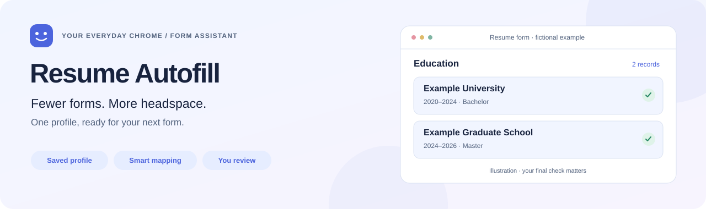
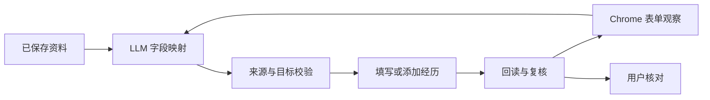

<div align="center">

# Resume Autofill

**少一点复制粘贴，多一点自己的时间。**

在你日常使用的 Chrome 里，让简历资料变成网页上的答案。

[简体中文](README.md) · [English](README.en.md)


[快速开始](#quick-start) · [日常使用](#using-it) · [常见问题](#faq) · [自主 Agent 项目](https://github.com/SprayWaterXCW/resume-agent-lab)

</div>

<picture>
  <source media="(prefers-color-scheme: dark)" srcset="docs/assets/hero-dark.svg">
  
</picture>

## 👋 你好，又遇到一张简历表格？

你的资料写着「毕业院校」，网页却叫「毕业学校」；你有两段教育经历，页面最初只给了一张卡片。重新打字、找下拉选项、补经历……这些小事很容易占掉一整个晚上。

Resume Autofill 是为这些时刻做的填写助手。你先维护一份资料库，再在招聘表单上点击 **「开始填写此标签页」**。它尝试理解字段的意思、添加缺少的经历，并把执行结果留给你核对。

**当前提供 Chrome 扩展 + 本地服务的源码安装方式。** 实际填写效果取决于网页控件和模型，遇到缺少资料或无法确认的地方仍需要你接手。

## ✨ 它能帮上什么忙？

| 你遇到的小麻烦 | 助手的做法 |
| --- | --- |
| 同一件事，各家公司叫法不同 | 用 LLM 匹配网页字段与资料含义，并校验来源 |
| 经历有好几段，网页空位不够 | 识别经历区块，尝试添加卡片并重新观察页面 |
| 学校、日期、奖项需要选项或分项 | 处理已支持的下拉、自动补全、日历和结构化字段 |
| 奖项和竞赛被混在同一个区块 | 根据页面区块组织记录；分开出现时分别填写 |
| 想边填写边浏览别的页面 | 每个任务绑定原标签页；各标签页可分别开始、查看和停止 |
| 想知道哪里填好了、哪里还空着 | 查看逐项结果、来源路径和失败阶段，继续人工核对 |

资料编辑页支持基本信息、身高体重、联系方式、家庭成员、教育、实习、项目、校园经历、语言、证书、获奖、竞赛及自定义问答。**缺少资料不会编造答案，也不会因此清空已有内容。**

<a id="quick-start"></a>
## 🚀 快速开始

准备 **Node.js 22+、Chrome 116+**，以及支持 OpenAI 兼容工具调用的模型 API。目前以 **macOS** 为主要验证环境。

### 1. 下载与构建

```bash
git clone https://github.com/SprayWaterXCW/resume-autofill-extension.git
cd resume-autofill-extension
npm ci
npm run build:extension
cp .env.example .env.local
```

打开新建的 `.env.local`，填写你自己的配置：

| 配置项 | 填什么 |
| --- | --- |
| `RESUME_AGENT_API_KEY` | 模型服务商提供的 API Key |
| `RESUME_AGENT_BASE_URL` | 服务商的 OpenAI 兼容 API 基础地址 |
| `RESUME_AGENT_MODEL` | 该服务商实际支持的模型 ID |

模板中的服务商与模型只是默认值，请按自己的 API 账户调整。Base URL 填基础地址，避免填写完整的 `/chat/completions` 请求地址。

### 2. 启动本地服务

```bash
npm run demo:service:start
```

服务在后台运行，地址是 **[127.0.0.1:4174](http://127.0.0.1:4174/?runner=browser-use)**。这条启动方式可以关闭终端；重启电脑后需要重新启动服务。

### 3. 加载 Chrome 扩展

1. 在 Chrome 地址栏输入 `chrome://extensions`。
2. 打开右上角 **「开发者模式」**。
3. 点击 **「加载已解压的扩展程序」**，选择本仓库里的 `agent-extension` 文件夹。
4. 将 **Resume Agent · 当前标签页入口** 固定到工具栏。

### 4. 准备资料，开始填写

打开扩展，点击 **「编辑资料 · 打开网页」**，填写并保存你的资料；也可以导入自己的资料备份。随后打开招聘网站的简历编辑页，点击 **「开始填写此标签页」**。

> [!TIP]
> 想先熟悉界面？打开 [本地虚构表单](http://127.0.0.1:4174/?runner=browser-use)。演示只用于熟悉流程，真实网站的填写结果需要另外核对。

<a id="using-it"></a>
## 🧭 日常使用，一次一张表

**维护资料 → 打开表单 → 选择模式 → 开始填写 → 查看记录 → 亲自核对。**

| 模式 | 适合什么时候 |
| --- | --- |
| **全部覆盖 · 默认** | 用当前资料更新可编辑字段；缺少来源的字段保持原样 |
| **只填空白** | 已经手动填了一部分，希望保留现有内容 |

经历日期只有年月时，可以主动开启 **「按当月 1 日补全」**。每次补全都会记录这条已确认规则，资料原文保留原来的精度。

你可以切换标签页或关闭扩展面板，任务继续处理启动时的页面。刷新、跳转或关闭原页面会结束该页任务。更新资料和日期规则前，先等正在运行的任务结束。

**最后的决定留给你。** 助手不操作保存、提交、投递、签名或声明；网页按钮与网络请求可以照常由你使用。输入框显示有值也不等于网站已保存，请检查网站自己的预览或保存结果。

<a id="faq"></a>
## 💬 遇到问题，先看这里

<details>
<summary><strong>点击开始后没有反应，或者提示服务无法连接？</strong></summary>

在仓库目录执行：

```bash
npm run demo:service:status
npm run demo:service:start
```

修改模型配置后，用 `npm run demo:service:stop` 停止服务，再重新启动。确认加载的是这个仓库的扩展，且服务地址使用 4174。

</details>

<details>
<summary><strong>资料里有答案，为什么网页还是空白？</strong></summary>

打开扩展的「执行记录」与逐项结果。可能是没有可靠映射、选项不匹配、控件尚未准备好，或网页没有接受输入事件。缺少资料与执行失败是不同问题。复杂自定义控件、iframe、Shadow DOM 和文件上传仍有覆盖限制；必要时手动补齐。

</details>

<details>
<summary><strong>我需要换一个 Chrome，或者重新登录招聘网站吗？</strong></summary>

使用你平时的 Chrome 和已有登录状态。日常填写不需要专用浏览器、远程调试或 debugger 权限。首次加载扩展需要开启开发者模式。

</details>

<details>
<summary><strong>资料和 API Key 放在哪里？</strong></summary>

资料保存在扩展本地存储，API Key 在本机 `.env.local` 中。填写规划向你选择的模型服务发送字段标签、页面结构与资料目录，不发送真实简历值。编辑资料可以离线使用；模型请求需要网络，并可能产生服务商费用。换机或卸载扩展前，先导出资料备份。

</details>

<details>
<summary><strong>更新代码以后，还需要做什么？</strong></summary>

更新源码后重新运行 `npm ci` 与 `npm run build:extension`，在 Chrome 扩展页点击「重新加载」，并停止、重启本地服务。保留自己的 `.env.local`；首次安装的复制模板步骤无需重复。

</details>

## 🛠️ 想了解里面怎么工作？

这个项目的真实填写入口采用 **LLM 字段映射 + 程序管理的执行循环**。扩展负责观察和填写，本地 Node.js 服务连接模型，每项写入都要经过来源、目标与页面状态检查。



| 想继续看什么？ | 入口 |
| --- | --- |
| 当前架构与 Chrome 工具栏入口 | [架构](docs/architecture.md) · [入口设计](docs/browser-entry-design.md) |
| 一边做一边学的技术笔记 | [学习文档](docs/lessons/) |
| 测试、真实验收与已知问题 | [评测说明](docs/evaluation.md) · [当前版本回归记录](reports/background-tabs-regression-2026-10-08.md) |
| 原来的阶段记录 | [开发历史](docs/development-history.md) |
| 模型自主选择下一步的实验项目 | [Resume Agent Lab](https://github.com/SprayWaterXCW/resume-agent-lab) |

开发检查：`npm test`。合成模型评测：`npm run eval:benchmark`，会调用你配置的模型并可能产生费用。Python Browser Use 对照实验保留在研究文档中，日常填写入口采用本项目的 Chrome 扩展。

## 🤝 一起把它做得更好

欢迎 [报告问题或提出建议](https://github.com/SprayWaterXCW/resume-autofill-extension/issues)。说明扩展版本、控件类型和预期行为，附上脱敏的执行记录或虚构资料复现，会更容易定位问题。

复用代码的来源与 GPL-3.0 许可证保留在 [src/vendor/formfill](src/vendor/formfill/README.md) 中。README 的展示图是虚构示意图。
