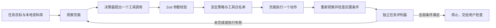

# 架构与边界

## Node 基线的运行流

Node 内核的 `B/F` 可以是内存中的合成环境、本地招聘页的 DOM 适配器，或普通 Chrome 扩展所选标签页的脚本适配器；`C` 可以是脚本测试替身，也可以是 OpenAI 兼容模型适配器。扩展通过本机 WebSocket 请求模型决策，API Key 不进入扩展。真实表单另有 `real-runner.js`：先生成受校验的语义映射，增补经历后重新规划，逐字段执行并持续回读。已有京东方部分填写实测，多网站覆盖与统一的真实成功率评测仍待完成。

## 各部分的责任

- **资料库（Node 基线）**：值只在本地 `catalog.getValue()` 取出。决策器只接收 `path/label`，不接收资料值。浏览器页面已经显示的值也在送入决策器前变成 `filled: true/false`。
- **资料账本**：`profile-ledger.js` 检查来源和候选确认状态，冲突未解决时不给出可用值；公开目录包含区块、记录索引、状态及来源关系。`profile-import.js` 接入原插件 JSON，真实值保存在扩展本地；`form-answers.js` 生成可追溯的确定性表单答案。
- **观察器**：把页面转成字段、区块、卡片数、可操作控件。观察是事实输入；网页文字应视为不可信数据，不应变成系统指令。
- **决策器**：每轮提出结构化动作、宣布完成，或因不确定而 `halt`。第一阶段用脚本替身；第二阶段新增了原生函数调用适配器。模型即使一次提出多个工具建议，运行时也只在全部建议安全时采纳第一项，重新观察后再决策。它没有直接操作 DOM 的权限。
- **工具注册表（Node 基线）**：只存在 `add_entry` 和 `fill_field`。Zod 校验参数；策略检查目标；具体工具在本地执行。没有通用点击和提交工具。
- **后置条件验证**：`add_entry` 必须让卡片数增加且出现新字段；`fill_field` 必须回读到预期值。调用成功或页面没报错不等于填写成功。
- **任务评判器**：使用测试内部的预期值独立判断任务是否完成。模型说“完成”不能替代检查；未完成时继续循环，超过预算则返回 `incomplete`。
- **轨迹**：记录工具名、目标标识、验证结果和错误码；真实控件增加执行阶段、计数、耗时及布尔回读状态。模型 HTTP 失败只记录状态码，不写响应体或密钥；真实执行记录不包含资料值、完整私人网址或请求正文。

浏览器演示还接收实时阶段事件：开始判断、提出动作、通过安全检查并开始执行、页面回读结果。步骤卡片用这些事件分别显示“观察、判断、准备、执行、核验”。模型可为动作附上一句简短的 `rationale`，它只作为用户可见的**决策摘要**；记录中的执行和核验仍以程序事实为准。摘要不进入下一轮模型历史或持久轨迹，显示前还会遮盖与本地资料值完全相同的片段。

## 普通 Chrome 工具栏入口

Manifest V3 扩展用 `activeTab` 取得用户点击时的当前标签页，用 `chrome.scripting.executeScript` 在这个 `tabId` 上执行受控的 DOM 观察和动作。只有启动时检查活动标签页；每一步检查原标签页的精确网址与 Chrome documentId，页面绑定再检查控件身份。WebSocket 把不含资料值的规划上下文送给本机模型服务，并用心跳维持长任务。切换标签页或关闭弹窗后任务仍在原页面执行。后台按 `tabId` 建立独立任务槽，状态、计划和扫描分别保存在 `chrome.storage.session` 的 `agentTabTask:<tabId>` 中；每个任务使用独立 WebSocket、取消信号和 `runId`。同一页的扫描、规划和执行互斥；不同页可并发。网页短等待通过仅允许当前任务文档的扩展消息移到 service worker，避免 Agent 自己的网页计时器被后台限速。这个入口不使用 CDP、调试端口或另一个 Chrome 资料目录。

当前扩展支持本地虚构演示和已导入资料的真实表单原型。受限适配器涵盖原生输入、下拉、自动补全、Phoenix 日期/月份、自定义单选及已核实的民族/地区弹层。未知控件、来源缺失及候选歧义作为未完成保留。0.6.8 的两个新弹层适配器已通过合成测试，换机后的真实执行仍需验收；没有实现自动保存或提交。详见[第八课](lessons/08-real-form-execution.md)与[第十二课](lessons/12-picker-protocols-and-public-dictionaries.md)。

只读规划链路为：扫描 → `createPlanContext` 白名单投影 → 本机服务/模型的 `propose_form_mapping` → `buildFillPlan` 独立引用与记录检查 → 再次扫描 → 展示。模型接口没有页面动作，建议的 `executable` 恒为 `false`。计划单独保存到会话状态，按标签页和网址绑定；后台中断报告失败。SHA-256 标识只覆盖所扫描元数据与公开目录，不证明真实值或全部 DOM 没有变化，后续工具执行仍需现场校验。

0.7.9 的操作边界约束 Agent 的工具调用。扩展不阻断网页网络，不拦截用户点击或提交事件，不改写 fetch、XHR、sendBeacon、window.open 或 HTMLFormElement 方法。真实工具通过只读脚本取得 documentId，再绑定该文档执行；刷新、跳转或关闭原文档使该任务失效；切换活动标签页不影响任务。同文档内的结构变化由有界重新观察与规划处理。旧版钩子与会话规则仅由 removal-only 迁移代码清理，任务结束后释放隔离世界运行时的日期监听与回读凭据，网页内容保留。

## 网页资料编辑与本地事实来源

0.7.0 的工具栏按钮打开扩展自身的 profile-editor.html，options_ui 也提供同一入口。编辑器复用简历 schema 生成分组和多条记录，自动载入已保存资料。编辑和保存不依赖本机模型服务；保存后下一轮执行从同一份本地资料建立事实库。

profile-store.js 串行处理编辑保存和备份导入，每次写入生成 revision。编辑器保存时核对 baseRevision；旧窗口不能覆盖新版本。任一标签页任务运行期间拒绝更换资料，写入排队期间拒绝启动新任务，成功写入使旧只读计划失效。未保存内容留在表单中，离开页面会提醒，用户可以导出备份。

整份资料的 profile-editor-load / profile-editor-save 消息仅允许本扩展的编辑页发送方。工具栏继续读取不含值的摘要，模型继续读取标签和路径。Chrome 权限和扩展 ID 保持，资料内容不写入执行轨迹。见 [第十三课](lessons/13-profile-editor-and-fact-store.md)。

0.7.2 用私有 awardRecords.awards / competitions 数组作为两类经历的正式资料来源，每条记录包含稳定 UUID、name、scope、rank、description。编辑器提供四个字段及增删按钮，稳定 ID 使改名和删除其他条目不会串接元数据。旧 additional 文本和 0.7.1 awardDetails 在加载时迁移；名称取第一行、详情取其余行，原文保留为私有 legacyText 迁移证据，已明确确认的 scope/rank 按旧关联规则迁入。规范化后清空旧文本来源，旧大文本框不再成为填写来源。显式空数组表示用户删除，不能再从旧文本恢复。

事实目录以 awards.i.name / scope / rank / description 和 competitions.i 的相应路径暴露独立来源，所有字段仍属于同一记录；空属性不产生事实，UUID 和迁移档案不会进入模型或执行来源。模型契约与本地校验分别限制名称、详情、级别和等次。level 是只供选项控件使用的本地投影，derivedFrom 标明已存在的 scope / rank，私有载荷不会进入模型或日志。执行器打开当前等级选项后区分范围与等次，选择唯一对应选项并回读；没有所需来源、含义混合或多个同义候选时停止该字段。模型工具契约约束可选轴和明确获奖区块的记录位置，程序独立复验。见 [第十四课](lessons/14-award-levels-and-grounding.md)与[第十五课](lessons/15-structured-award-records.md)。

0.7.3 的映射增加 semanticRole 枚举。已观察标签有明确含义时，模型角色不得与之冲突；标签使用陌生叫法时，模型可提出角色，程序检查其来源属性及记录归属。同一卡片有明确名称字段时，未知相邻字段不能再占用 name。计划校验先定位具体语义冲突，局部修复保留独立有效字段；两个同样明确的名称字段争用一个来源时仍报告冲突。

summary 是本地对已确认属性的确定性格式化。每条 summary 的 derivedFrom 指向原始属性，全量 formAnswers 汇总指向每条 summary。模型只收到路径和用途说明，不接收组合后的值；任何已存在属性未确认或冲突，都不会生成会掩盖该问题的完整汇总。page.groups 增加由观察中添加候选生成的 hasAddCandidate 布尔标志。只有未截断页面中一个字段、一个条目且无添加候选的文字区块可以选择全量汇总；多个字段或可添加卡片的表单继续按记录规划。只有获奖分区时汇总包含竞赛，同时存在两类分区时分别汇总。无公司域名或专用页面选择器参与这项路由。

获奖诊断记录已观察角色、模型角色、计划角色、已知来源路径、各记录可用属性及剔除结果。陌生分组也可通过已验证来源引用纳入诊断。日志不保存标签原文、资料值和未知模型引用。服务端同时记录成功与失败规划，客户端局部修复事件带同类诊断。见 [第十六课](lessons/16-cross-company-award-semantics.md)。

0.7.4 将完整校验上下文和送给模型的候选视图区分。输入先按完整快照校验，工具契约排除已有值、禁用、声明等目标；模型视图仅包含待处理字段、可选来源及递归来源关系，另保留完整 section 的条目计数。模型返回完整观察的 snapshotId，服务端和扩展仍按完整原始上下文检查映射，卡片缺口也按完整本地资料计算。工具分支给出的来源不再在描述中逐字段复制，外层 sourcePath 枚举取分支来源的并集。

PLAN_MODEL_RESPONSE_INVALID 现在带封闭的 responseDiagnostic，分别表示没有工具调用、调用数量错误、工具类型错误、输出截断、JSON 参数错误或 schema 字段错误。诊断只有类型、长度、白名单字段路径、数量及提供商 token 指标，没有参数片段、未知属性名或响应正文。服务端、WebSocket 客户端和错误反馈分别校验它；格式错误进入既有最多三次规划循环，每次重试前复查页面，最终有效计划通过后才进入添加或填写。

映射的可选 semanticRole 接受 null 作为未提供，并在输出中移除。已知普通资料、普通目标上的获奖角色注解也移除；目标和来源引用保持原样。未知角色、额外资料值、未知引用、获奖目标上的语义冲突仍由 schema 或完整校验拒绝。见 [第十七课](lessons/17-model-response-and-context-budget.md)。

## Browser Use 试运行

作为对照实验，Python 路径直接使用 Browser Use 的 `Agent`、`BrowserSession` 和 `Tools`。它读取本地页 DOM，在每轮选择一个动作，再读取动作后的页面。项目自定义 `add_demo_education` 和 `fill_demo_field`，删除框架默认的通用点击、导航、输入、脚本等动作，并核查最终注册表。DeepSeek JSON object 适配器只负责模型输出格式；独立 DOM 判分器负责判断两段教育经历及四个字段是否正确。详见[改造说明](browser-use-migration.md)。

Browser Use 默认会把页面上已填写的值放入后续观察上下文，其步骤日志也会显示虚构值。这条试运行尚未接入真实资料库；不能把上面 Node 基线的“模型不接收资料值”承诺直接套到 Python 路径。真实资料接入前需要重新设计脱敏、日志和上下文边界。

## 严禁提交的技术契约

1. 工具列表实行允许名单。未知工具调用在执行前返回 `UNKNOWN_TOOL`。
2. Node 内核和普通 Chrome 扩展没有通用点击、提交或导航工具；Browser Use 对照实验删除了通用点击、输入、导航、脚本和文件动作。Python 运行器只在启动时自行导航到固定本地页，模型不能提出任意网址。
3. 添加经历只能作用于观察中明确标记的添加控件；原生控件要求 `type=button`，非原生控件要求已核实的 Phoenix 结构，均不能有提交语义或 `formAction`，且卡片必须恰好增加一组。
4. 写值只作用于已观察且可写的字段，并且只从本地资料路径取值；默认不覆盖页面上不同的现有值。
5. 工具允许名单、目标语义与类型检查、资料来源校验和文档绑定约束 Agent 自己的动作；用户的手动操作与网站原有联网行为保持正常。保存草稿需要独立的、可验证的能力设计。

## 与旧版的关系

旧版扩展已有资料编辑器、字段扫描、控件适配和安全防护。新项目先建立可测试的 Agent 内核与评测标准，再逐个迁移已经验证的能力。旧版的「一次规划、批量映射、顺序填写」没有统一的任务级观察和复核循环；新内核让每一步的结果成为下一步的输入。
