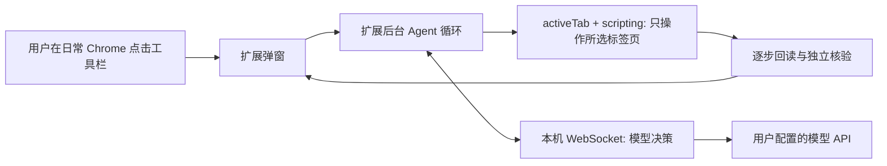

# 从普通 Chrome 当前标签页启动 Agent

用户在自己日常使用的 Chrome 中打开页面，点击工具栏中的 Resume Agent 图标。扩展只取得此次点击所选标签页的临时权限。用户可以在面板中看当前页、可用范围、Agent 最近的计划与动作、独立核验结果。Agent 始终停在待检查的表单；提交简历、投递、报名及等价动作不属于工具集合。

填写入口目前只允许本地虚构测试页。版本 `0.4.0` 增加真实网页只读扫描；`0.5.0` 增加用两段虚构教育经历生成只读填写计划。规划会调用本机 4174 服务与用户已配置模型，展示资料路径、记录缺口和控件适配需求，并复扫校验生成时的元数据。真实招聘站点的填写执行层和真实资料接入仍待完成。

## 组件边界

- `agent-extension/popup.js` 读取当前 `tabId`、URL 和标题，要求用户显式点击「开始填写」。弹窗只显示状态，不持有模型密钥。
- `agent-extension/src/worker.js` 运行现有 `runAgent` 闭环：观察 → 模型建议 → 许可工具检查 → 执行 → 再观察 → 核验。它按标签页把状态写入 `chrome.storage.session`，关闭弹窗或切换标签页后继续执行原页面的任务。
- 同一后台也运行 `generateReadOnlyPlan`，每个任务槽各自保存 `state`、`planState`、`lastScan`，以 `agentTabTask:<tabId>` 为会话键；同一页的扫描、规划和执行互斥，不同页可并发，模型等待期间页面变化会使计划失效。任务中断显示失败，尚未自动恢复。
- `agent-extension/src/demo-tab.js` 是浏览器工具适配器。它在每次脚本注入前核对标签页 ID 与 URL，在页面内再次核对精确地址；目前只实现本地教育经历页的“添加一张卡片”和“写入一个字段”。没有通用点击、导航或提交工具。
- `agent-extension/src/page-scan.js` 在隔离执行环境中扫描主文档的字段标签、分组、控件类型及按钮候选。杭州银行布局提示来自实际 Chrome DOM 检查；其他页面走语义标签扫描。报告使用本次观察的临时 ID，不包含字段值、Cookie、请求正文或页面内部应用状态。敏感字段、声明答案及凭据字段的值不读取。扫描前、页面内、扫描后均验证网址；它不启动模型或写入工具。
- `web-demo/agent-socket.js` 在本机 Node 服务上只接受固定扩展 Origin 的 WebSocket，校验请求结构，并调用现有 OpenAI 兼容模型适配器。模型只收到字段标签、路径和已填状态；资料值留在 Agent 工具侧。计划请求另用严格契约，服务与扩展两端检查模型引用，响应不包含实际值或动作。
- `src/core/runner.js`、`registry.js` 与评测器是可复用的 Agent 核心。Browser Use 的 Python 集成保留为研究对照实验；日常 Chrome 入口不调用 Browser Use 的 CDP 连接器。
- 0.7.9 移除网页网络拦截与提交事件拦截；仅通过受限工具、提交语义检查和 documentId 绑定约束 Agent 的动作。`agent-extension/src/legacy-page-cleanup.js` 只清理旧版本遗留的规则和页面钩子，不创建规则或改写网页 API。网页控件和用户手动操作保持正常。

## 为什么不用直接连接 Browser Use 的 CDP

Browser Use SDK 常用 CDP 控制一个由它启动或允许远程调试的浏览器。普通用户已经打开的默认 Chrome 资料目录不适合由本项目重新启动成另一份资料，也不应要求用户为了点扩展而重启浏览器或启用调试端口。Chrome 的 `activeTab` 与 `scripting` 正好覆盖“用户点一下，只操作这张标签页”的入口。这个选择保留 Agent 的观察与验证结构，只替换浏览器执行层。

Chrome 116 起，扩展后台 WebSocket 的收发可延长 service worker 生命周期。运行时每 20 秒发送一次心跳，模型决策通过本机连接返回。若后台意外中断，重开面板会显示中断状态，而不会谎称任务完成。

## 当前限制与下一步

1. 真实填写已接入普通招聘网页，支持多段经历、部分自定义控件、已有值保护与动态节点恢复；跨 iframe、文件上传及未识别的复杂控件仍需进一步验证。
2. 用户通过扩展网页资料编辑器维护事实库，也可导入原插件备份。模型只接收标签、资料路径和用途，工具从本地资料按路径取值；开发与评测继续使用虚构数据。
3. 发布给其他用户前，还需要打包扩展和本机服务、提供易懂的安装流程，并用多站点任务集评测成功率与提交风险。
4. 后台执行仍要求原文档存在。浏览器关闭、系统休眠、网页自身只在可见时渲染的控件，不由任务队列保证完成。后台中断会显示中断状态，不能自动重放旧计划。
5. 当前产品约束 Agent 的动作；网页请求、自动保存与用户手动按钮按网站原有逻辑工作，任务不需要手动恢复。陌生控件执行前仍须观察并核验协议。

## 多标签页与短等待

`worker.js` 的每个异步回调显式持有自己的任务槽，不从“当前活动标签页”寻找要修改的状态。停止、导航取消和短等待只作用于该槽。`real-tab.js` 使用 `documentIds` 限定执行文档；同网址重新加载的文档也不能接受旧任务的写入。共享资料采用只读快照，修改规则和保存资料等待所有任务结束。

`page-wait.js` 在隔离环境中向扩展发出仅含 `type`、`ms` 的消息。后台验证 `sender.id`、`sender.tab.id`、`sender.frameId`、`sender.documentId`、`sender.url`，且该页须正在运行。短等待限定 1–1000 ms，可随任务取消。测试环境没有扩展运行时时保留本地计时器；真实 Chrome 消息失败会停止动作，不回退到不受任务约束的等待。

## 资料

- [Chrome `activeTab` 临时权限](https://developer.chrome.com/docs/extensions/develop/concepts/activeTab)
- [Chrome `scripting` API](https://developer.chrome.com/docs/extensions/reference/api/scripting)
- [Chrome `declarativeNetRequest` 会话规则](https://developer.chrome.com/docs/extensions/reference/api/declarativeNetRequest)
- [扩展后台 WebSocket 生命周期](https://developer.chrome.com/docs/extensions/how-to/web-platform/websockets)
- [Browser Use 仓库](https://github.com/browser-use/browser-use)

- [Chrome 隐藏页面计时器限速](https://developer.chrome.com/blog/timer-throttling-in-chrome-88/)
- [Chrome MessageSender 文档身份](https://developer.chrome.com/docs/extensions/reference/api/runtime#type-MessageSender)
