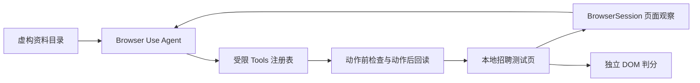

# 以 Browser Use 改造简历 Agent：第一步

## 这一阶段在整个系统中的位置

旧的 Node 内核证明了“观察 → 决策 → 执行 → 回读验证”的任务契约，也留下了 32 案例的合成评测基线。现在开始引入 [Browser Use 开源 Python Agent](https://github.com/browser-use/browser-use)，把浏览器会话、DOM 观察和模型循环交给成熟框架；简历资料映射、动作许可和独立验收仍由本项目定义。

| Browser Use 组件 | 在这里的职责 | 本项目补充的约束 |
| --- | --- | --- |
| `Browser` / `BrowserSession` | 启动隔离 Chrome，通过 CDP 观察页面状态 | 启动时只导航到本地测试页的 `?runner=browser-use` 模式；写入动作每次再次核对 URL |
| `Agent` | 反复读取页面、让 LLM 选择一步、接收执行反馈并继续 | 每步最多执行一个动作，防止一次决策把后续 DOM 当成已更新状态 |
| `Tools` | 把 Python 函数注册成模型可选动作 | 删除通用 `click`、`input`、`navigate`、`evaluate`、`send_keys` 等默认动作；运行前核对精确白名单 |
| `ActionResult` | 把执行结果或错误反馈给下一轮决策 | “添加一段”“填一字段”均有执行前检查、回读和重复执行处理 |
| 模型适配器 | 把页面状态变成符合 Agent 契约的结构化决策 | DeepSeek Chat API 使用其支持的 `json_object`；返回结果再由 Browser Use 的 Pydantic 模型校验 |

## 真实运行时发生了什么

1. 运行器检查本地演示服务、模型配置和 Chrome，启动独立的浏览器资料目录。
2. 运行器自己打开本地测试页的 Browser Use 模式，确认页面只有一张空卡片、网页内置演示器尚未运行。该模式停用页面上的“快速演示／真实模型填写／重置”按钮，模型没有导航工具。
3. Browser Use 向模型提供页面 DOM、工具说明和四个**资料路径**；工具从本地虚构资料中取值。网页字段“毕业学校”与资料路径“毕业院校”的同义关系由模型判断。
4. 模型选择 `add_demo_education`，工具只接受本地页上明确为 `type=button` 的“添加教育经历”，执行后回读卡片数量。
5. 模型逐个选择 `fill_demo_field`。工具核对 DOM ID 与资料路径一致、字段属于教育经历、可写、原值不会被覆盖；填写后再次读取页面。值已正确时直接确认，不重复写入。
6. Browser Use 根据新页面状态继续决策。它宣布完成后，独立判分器核对 DOM 值、Browser Use 自己成功执行的添加与填写动作，以及网页内置演示器运行次数。只要页面被另一条路径填好，而 Browser Use 没有完成这些动作，判分就不会通过。

## 为什么需要单独的 DeepSeek 适配器

Browser Use 默认的 `ChatOpenAI` 会向模型请求严格的 `json_schema` 响应。本机配置的 `deepseek-flash` 对这类 Chat Completions 请求返回 HTTP 400；仅把结构要求写入提示词又会得到非 JSON 的工具标记。DeepSeek [官方 JSON Output 文档](https://api-docs.deepseek.com/guides/json_mode/)要求使用 `response_format: {"type":"json_object"}`。因此 `ChatDeepSeekJsonObject` 只在 DeepSeek 官方域名上启用：它以 JSON object 模式请求模型，把 Browser Use 动作 schema 放进系统提示，并继续用 Pydantic 验证返回结果。非法动作即使形成了合法 JSON，也会被拒绝，例如模型曾提出已被移除的 `navigate`；该动作没有执行。

这说明 **JSON 合法性** 和 **动作合法性** 是两层不同约束。前者由模型接口保证，后者必须由运行时的 schema 和实际工具注册表保证。

## 当前验证与范围

- Browser Use `0.13.10` 的实际工具表只保留 `done`、`wait`、`find_elements`、`dropdown_options`、`add_demo_education`、`fill_demo_field`；安全测试检查通用写入与导航动作缺席。
- 最初的本地真实模型运行曾输出 `passed: true, correctFields: 4, cardCount: 2`，但一份用户运行记录显示 Browser Use 未调用添加动作、只调用了部分填写动作，页面却已填满。最终 DOM 正确不能证明动作均由 Browser Use 完成；因此增加了独立运行模式与动作归属判分。新判分同时输出 `agentAddedCards`、`agentWrittenFields`、`nodeDemoRuns`。
- 隔离后的真实模型复测通过：`passed: true`、`cardCount: 2`、`correctFields: 4/4`、`agentAddedCards: 1`、`agentWrittenFields: 4`、`nodeDemoRuns: 0`。Browser Use 在 6 个步骤中实际调用了添加卡片和四次字段写入，独立判分器逐项核对。这个结果只适用于虚构的本地页面。
- 演示页的提交按钮被禁用，服务的 CSP 禁止表单提交，页面没有招聘网站接口。本阶段只使用虚构资料与本地页面。
- 这条 Python 运行路径与现有 Node 网页演示是并行试运行。右侧网页执行记录仍属于 Node 路径；Browser Use 的步骤目前在终端，`--headed` 可以看到独立 Chrome 窗口。

## 下一步的验收顺序

1. 把 Browser Use 的结构化步骤与工具后置条件接入现有网页执行记录，并让用户能区分模型判断与实际页面证据。
2. 用同一批多经历、同义字段、奖项／竞赛、自动补全和下拉任务分别评测 Node 基线与 Browser Use 路径。当前的 25/32 结果不能算成 Browser Use 的成绩。
3. 在独立测试站点加入会产生隐藏提交副作用的控件，构建浏览器级的请求／导航阻断与回归测试。此关通过前，不向真实招聘网站开放写入动作。
4. 接入用户资料库的最小只读映射，再扩展到复杂控件、断点恢复和长任务轨迹。仍需避免把真实资料值写进持久日志或模型决策记录。
