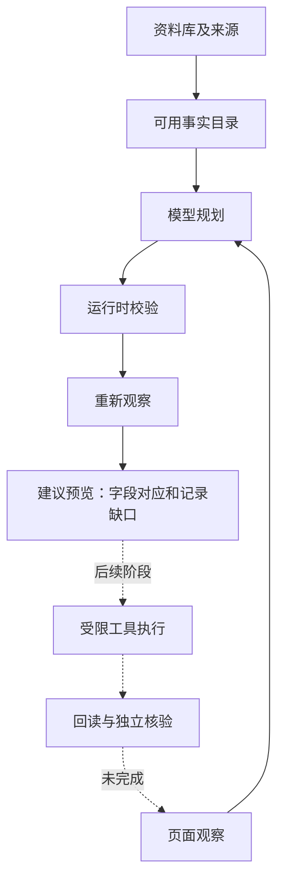

# 第七课：资料依据、结构化计划与重新观察

## 这一阶段处于整体的什么位置

上一阶段把真实网页变成字段、分组、记录索引和控件类型。本阶段把这些观察与资料目录连接起来，得到一份可以检查的填写建议。执行器以后消费经过校验的建议，再逐步操作并回读。当前真实网站写入尚未开放。



新增计划接口属于 Agent 的准备阶段。现有本地演示仍按观察、决策、执行、验证循环工作。日常 Chrome 路径使用本项目 Node 内核；Python 路径使用固定版本 Browser Use SDK 进行对照。本轮没有把扩展运行器换成 LangGraph，也没有声称真实招聘网站已经填写成功。

## 1. 为什么资料需要来源与状态

假设两份资料对第一段学校给出不同答案。模型可以理解网页问的是学校，却不能凭语言流畅程度决定哪份资料真实。我们把资料事实与候选来源分别记录：

```json
{
  "path": "educations.0.school",
  "label": "毕业院校",
  "sectionKey": "educations",
  "entryIndex": 0,
  "candidates": [
    { "sourceId": "current_resume", "value": "虚构院校甲", "status": "verified" },
    { "sourceId": "old_resume", "value": "虚构院校乙", "status": "verified" }
  ]
}
```

这是教学用虚构资料。运行时发现候选冲突，就把公开状态变为 `conflicting`，不给执行工具提供值。用户或已获授权的导入流程明确选择某个已核实来源后，才得到可用事实。`model_suggestion` 来源即使写着 `verified` 也不能自动成为事实；占位或未确认候选同样不可用。

这个概念叫 **provenance（来源追踪）**。它回答：答案来自哪里、当前是否已确认、是否有其他来源反对它。我们的代码验证的是记录和确认流程；证书或履历本身的真伪还需要材料和用户核实。

这一步参考了 [resume-autofill-agent 的资料协议](https://github.com/CCC-Zach/resume-autofill-agent/blob/c6456b64e5a1836d1875ecc61feed2c1fa108871/skill/resume-autofill-agent/references/intake-and-profile.md)。它让资料状态进入后续规划，而本项目将状态落实为代码约束。

## 2. 模型为什么只获得路径和标签

本地账本持有实际值。给模型的公开目录是：

```json
{
  "path": "educations.0.school",
  "label": "毕业院校",
  "sectionKey": "educations",
  "entryIndex": 0,
  "status": "verified",
  "evidenceCount": 1
}
```

模型据此判断“University / college attended”对应哪个路径。未来执行工具再在本地按路径取值。这样能够把语义匹配与持有实际资料分开，减少填写计划和日志中的资料暴露。

这也有实际限制：仅有标签不能决定“流利”应对应网站的哪一个熟练度，也不能决定某个学校的具体选项。需要用户已经确认的选项偏好、可见选项，以及工具侧的受限匹配与回读。我们此前确认的“该网站英语掌握程度选良好”应作为有适用范围的选项偏好处理，不能悄悄改成通用个人事实。

## 3. Function calling 与 Zod 分别做什么

模型获得一个规划函数 `propose_form_mapping`，返回如下结构：

```json
{
  "snapshotId": "<当前观察的标识>",
  "groupMappings": [ { "groupId": "group-1", "sectionKeys": ["educations"] } ],
  "fieldMappings": [ { "fieldId": "field-1", "sourcePath": "educations.0.school" } ],
  "unresolved": []
}
```

函数调用把输出约束为程序可读取的数据。**Zod** 在运行时检查键、类型、数组长度、枚举与额外属性：例如模型输出 `value` 或 `click`，会直接被拒绝。JSON 解析成功之后，运行时继续检查字段是否存在、路径是否存在、是否重复，以及第一张经历是否对应第一条资料记录。

可以把这里的检查分为三层：

| 层 | 检查的问题 | 例子 |
| --- | --- | --- |
| 语法/结构 | 数据形状能否处理 | 必须是规定的函数参数；不能夹带实际值 |
| 引用/规则 | 数据是否属于当前任务 | 不允许虚构字段，不允许把第二段资料写到第一段记录 |
| 语义/结果 | 对应是否合理，动作是否达成 | 学校是否匹配学校；选项是否真的选中；整份资料是否完整 |

本轮实现前两层及建议预览。真实模型小样例检查了部分语义匹配；真实控件结果验证是下一阶段。schema 不能独自证明字段语义正确。

## 4. 多经历为什么要先形成记录池

资料里有两段教育经历、网页有一段时，观察中没有第二张卡片的字段 ID。模型只映射已有字段；程序计算资料记录数与网页记录数的差，显示“需增加 1 组”。以后执行器增加一组并重新观察，才获得新字段 ID。

获奖/竞赛也是类似结构：合成评测中有五个奖项和两个竞赛。只有获奖区块时，把两个资料区块排成七条记录的池；网页只有一组就还需六组。网站有分别的区块时，分别计算五条和两条记录。一个资料区块不能被重复分配到两个页面区块。

当前记录顺序采用已给出的资料索引和所选区块顺序。它还没有根据日期做跨区块排序，也不能自动证明最高学历顺序正确。真实导入阶段应先确认排序规则，避免卡片看似完整却顺序错误。

## 5. 为什么模型等待之后要重新观察

用户可能在模型请求期间手动填一个字段，网页也可能动态改变卡片。我们用 **SHA-256** 对页面元数据和公开资料目录形成观察标识。生成建议后再次扫描；两次标识不同，本次计划作废。

SHA-256 在这里用于检查两份数据是否一致。它没有加密页面，也没有证明数据真实。输入不含资料值，计划也不输出资料值。它只能发现扫描所覆盖的元数据变化；相同标签与已填布尔状态不能证明底层 DOM 或实际值没有变化。后续执行前还要重新定位目标并回读，不能只相信旧快照。

## 6. 怎样看执行记录

新面板显示四个有程序事件依据的阶段：

1. **观察**：读取字段、控件类型和记录数量。
2. **模型映射**：让模型提出路径对应。
3. **校验**：检查来源状态、字段引用和经历位置。
4. **重新观察**：检查模型等待期间页面是否变化。

逐字段状态解释为什么当前只能做到某一步：

- “已关联资料”表示路径存在、来源可用、记录位置符合约束；语义仍需要检查。
- “需控件适配与选中核验”表示识别到了对应资料，但自动补全、下拉或日期工具尚未执行。
- “保留已有内容”表示扫描已知该字段有内容，或该输入不可写。
- “值未读取，需人工核实”表示扫描刻意不读取该类值，无法据此确认为空。
- “目录没有对应资料”是模型的缺资料判断；如果实际资料应该存在，就需要检查导入与模型映射。
- “模型未提供映射”表示建议不完整，不自动解释成资料缺失。

这些记录说明打算怎样对应，以及程序实际检查到了哪里。它们没有展示逐字内部推理，也没有把建议说成已执行动作。

## 7. RAG、记忆和 LangGraph 接下来怎样进入

**RAG** 用于从大量材料中找出相关内容。用户已有结构化资料库时，先提供完整的字段与记录目录，避免只取 top-k 片段而漏掉后面的奖项。以后解析 PDF、证书或项目材料时，检索结果进入“待确认候选”，保留来源，再成为可用事实。[autofill 的检索评测](https://github.com/jayzuccarelli/autofill/blob/a6115e4b74e5dd645bee643a1dda0d604c793c73/evals/README.md)提供了分层检查召回的例子。

**记忆** 可以保存用户已授权的选项偏好和经验证的网站操作经验。[LangHire 的 SQLite 库](https://github.com/recepsuluker/langhire/blob/0613cd865794196ea66e692c408d440668ac1e8d/backend/memory/store.py)展示了按网站组织经验的方法。我们还要记录适用范围、观察版本、成功/失败证据和失效条件；不能让一次模型猜测变成下次自动使用的答案。

**LangGraph** 适合把长任务表示为观察、规划、等待人工、执行、核验、恢复等状态，并管理持久检查点。后续恢复不能直接重放旧动作：先确认网址、重新观察、检查已经完成的值和记录数，再决定下一步。当前 `chrome.storage.session` 的状态展示还不是可靠的任务恢复机制。

## 8. 使用与验证

在项目目录执行：

```sh
npm test
npm run build:extension
npm run demo:service:start
```

在普通 Chrome 的扩展页重新加载 Resume Agent。打开招聘表单或本地虚构页，点图标，再点“生成填写计划（虚构资料）”。这个按钮调用本机 4174 服务和已配置模型；它只使用两段虚构教育经历。其他区块没有资料依据是预期状态。

真实模型规划样例：

```sh
npm run eval:plan -- --output=reports/plan-model-smoke-2026-10-04.json
```

当前有三项小样例，不能用 3/3 推断真实网站成功率。程序测试、模型语义、浏览器控件结果和整份任务结果需要各自的证据。完整仓库对照与本轮验收见 `reports/github-resume-agents-2026-10-04.md`。
