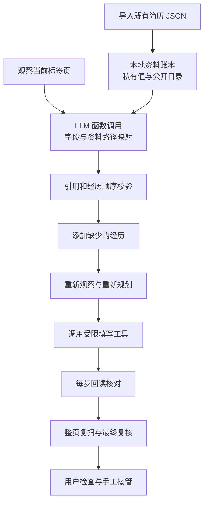

# 第 8 步：让 Agent 开始填写真实网页

> 版本说明：本文保留该阶段的设计记录。0.7.9 已移除网页网络屏蔽、提交事件拦截与手动恢复步骤；当前操作边界见 [第二十二课](22-agent-actions-and-user-control.md)。控件适配与回读核验仍然保留。

## 这一步解决什么问题

此前我们已经能识别招聘网页，使用模型提出字段映射，但真实填写入口仍然关闭，而且模型只看到了两段虚构教育经历。这一步把已有资料和浏览器执行接入同一条流程。现在可以导入原插件的简历 JSON，在普通 Chrome 选择一个招聘表单，实际填写可支持的空白字段。

第一次目标是做出可使用的原型：支持的字段填进去，不支持的控件明确留下，过程可以查看和停止。它不要求每个招聘网站、每种控件一次全部填完。

## 整体流程

资料内容不进入模型请求。模型看到“网页字段是毕业学校，资料路径是 educations.0.school，标签是学校名称”，提出这两个字段对应。执行器随后在扩展本地取出实际学校名称，写入网页。

## 直接复用了哪些代码

我们复制了原插件的三个模块到 Agent 的 `src/vendor/formfill`，原插件源文件未改动：

- `resume-schema.js`：已有资料字段、字段别名、数组经历、日期规范化和资料目录。
- `dropdown-select.js`：主流组件的弹层选择器、选项同义匹配、数字格式匹配和此前确认的语言程度偏好。
- `write-fixes.js`：将获奖、竞赛的项目符号原文拆成独立条目。

原插件用 `additional.awards` 和 `additional.competitions` 保存文本。Agent 会增加 `awards.0.name`、`competitions.0.name` 等虚拟资料路径。它们保留原文内容，提供可以计数、分配和索引的记录。模型看不到这些条目的具体文本。

网页只有获奖分组时，记录池可以按“全部奖项，然后全部竞赛”排布；网页有两个分组时分别分配。模型提出分组对应关系，运行时独立检查记录数量和来源索引。

## 1. Agent 的观察、计划、动作和验证

参考 [Browser Use 的 Agent 实现，固定版本 0.13.10](https://github.com/browser-use/browser-use/blob/0.13.10/browser_use/agent/service.py)，这里采用“观察页面 → 模型规划 → 执行工具 → 验证结果 → 继续观察”的闭环。

观察得到字段标签、控件类型、分组、经历数量和已有内容的存在标记。计划用函数调用提出结构化引用。执行器只提供添加经历和填写绑定字段的能力。验证包括每步回读、新增记录数量检查以及整页完成后的再次核对。

这条真实页面路径采用 LLM 生成映射计划，再由受限执行器完成一批动作。新增经历后重新调用模型。它尚未等同于 Browser Use 的完整通用动作循环；暂时没有任意浏览器探索、截图视觉定位或模型对每次失败重新规划。已有 Python / Browser Use 路径继续用于此前的演示与评测。

## 2. 函数调用和 Zod 校验

模型调用 `propose_form_mapping`，返回分组 ID、字段 ID、资料路径和待确认原因。模型无法通过这个接口提供任意 JavaScript、输入值或提交动作。

Zod 先检查数据形状，然后程序检查引用是否真实存在、是否重复、是否串填不同经历。比如第二张教育卡片必须对应第二条教育资料。基本信息、联系方式和证件资料都是单个资料对象，可以共同映射到同一个基本信息分组。

这是“模型负责语义选择，程序负责执行边界”的具体分工。规则需要解决控件的确定性行为；“学校”和“院校”的语义对应交给模型。

## 3. Chrome 的隔离世界和真实 DOM 绑定

`activeTab` 让用户点击工具栏时授权当前标签页。执行代码通过 `chrome.scripting` 注入到隔离世界中，保存真实 DOM 元素的引用和随机绑定令牌。

每次填写都检查页面 URL、当前标签页、元素是否仍在页面，以及标签和控件类型是否一致。模型不能直接指定 DOM 选择器，避免引用不存在或已经变动的元素。

文本使用原生 `value` setter，再派发 `input`、`change` 事件，让 Vue、React 等页面有机会同步表单状态。随后回读。仅改变输入框显示不能证明远程服务器已接受内容，因此此版本只报告浏览器内的填写结果。

## 4. 下拉框不能只输入搜索文字

自定义下拉采用“展开 → 找到属于这个控件的候选 → 匹配 → 点击候选 → 回读 → 关闭弹层”。如果没有候选，搜索词会恢复，报告 `OPTION_UNAVAILABLE`，继续其他字段。

这避免此前的假成功：输入框出现了学校名称，但实际没有选中学校。原生下拉和部分自定义下拉已经接入。级联地区、只读日期选择器、复杂弹窗和需要远程检索的控件尚未完整覆盖。

## 5. 逐步验证和最终复核

每个写入动作只有回读一致才计入“写入字段”。执行器在隔离世界保留私有写入凭据，内容不返回后台或模型。整页填完后重新扫描，再检查已写字段是否仍保留当时选中的值。

后面的控件可能触发页面重渲染，把前面的输入清掉。最终复核会撤销这些字段的成功计数并标出 `FINAL_READBACK_MISMATCH`。这种验证比“没有抛异常就认为成功”更适合招聘表单。

## 真实网站暴露出的两个问题

京东方简历编辑页的第一轮扫描发现 59 个控件，却有 58 个标签无法识别。通过 Chrome 的 Elements 面板读取实际结构后，发现它采用 Phoenix 组件：标签位于 `.form-item__title .form-item__text`，输入框位于 `.phoenix-input` 或 `.phoenix-select`；分组标题是普通 `div`，没有标准的 `section` 或 `fieldset`。

因此观察适配器补入了这套结构。它沿父节点寻找一个“直接标题加表单容器”的边界，使用 `.ux-standard-form` 区分经历卡片，避开每次构建可能变化的 styled-components 类名。修复后，同一页面识别到 8 个字段分组，标签缺失降为 2 个。两个缺失项没有足够语义依据，留待人工处理。

Phoenix 的选项面板位于 `.phoenix-selectList`，选项是 `.phoenix-selectList__listItem`。真正选择后，组件把标签放进 `.phoenix-select__content`，搜索输入可以为空。因此本地执行器检查提交到组件的显示标签，不把输入了搜索文字当成选中了选项。已有显示标签的控件会受到保护。

随后实际模型请求被 `PLAN_DUPLICATE_REFERENCE` 拦截。补充日志后定位到 `jobPreferences` 同时分配给个人信息与附加问题。这里暴露的是数据结构和网页布局之间的差别：资料库中的一个普通对象，可以在网页上拆成多个分组。我们允许不带记录索引的资料对象跨分组使用，仍限制重复经历的分组和记录顺序，并检查同一资料路径是否被重复用于字段。

这两次修复分别属于 **观察适配器** 和 **计划校验器**。它们说明 Agent 的失败不一定来自模型：观察漏掉标签会让模型无从判断，过严的程序约束也会拒绝合理建议。错误诊断现在包含冲突类型、字段 ID、分组 ID 和资料路径，继续排除实际资料值。

## 6. 当前网络保护和人工接管

真实填写期间，Chrome 为当前标签页安装网络阻断规则，并拦截主文档的表单提交、直接 `submit/requestSubmit`、部分请求 API 和最终动作按钮。执行工具没有提交、签名、保存或任意点击能力。

本版在尝试过填写或添加经历的任务结束、失败或停止后保留本轮页面保护，用户检查后点击“恢复正常浏览”，再手工继续。若任务只进行观察和规划就失败，尚未尝试操作表单，则自动恢复访问。0.6.5 还允许刷新同一表单：重载会停止旧任务、自动清理旧保护，并使旧映射失效。未保存内容可能随刷新丢失。需要远程学校搜索、地址联动等请求的控件仍可能失败。

保护覆盖所选标签页和注入的主文档。框架、Shadow DOM、页面已有 worker 和其他浏览上下文尚未全部适配，不声称覆盖所有网站的全部后台行为。关闭或重新加载扩展也会影响 Chrome 的会话规则。工具层仍严禁主动执行提交类动作。

### 为什么恢复网络不能依赖网页脚本

真实测试中，用户返回职位页时出现 `ERR_BLOCKED_BY_CLIENT`。原因是网络规则包含顶层页面请求，而上一轮规划失败后仍留下了规则。旧恢复流程先向网页注入清理脚本，再删除规则；Chrome 自己的错误文档不允许这种注入，导致恢复动作也失败。

0.6.2 将页面清理和浏览器规则恢复分别处理：先核对规则归属，只解除本扩展为对应标签页安装的规则；页面注入失败会记录 `PAGE_CLEANUP_UNAVAILABLE`，继续删除规则并检查确实已删除。对已经换了网址的新文档跳过旧文档清理，避免操作错误页面。

另外，实际观察到扩展重新加载后，面板状态已清空而浏览器规则仍保留。因此后台启动时会检查真实的会话规则，发现残留规则便恢复手工接管入口。它不会仅凭没有面板记录就认为保护不存在，也不会把后台中断时无法确认副作用的任务自动解除。

这里用到的是资源清理、故障恢复和状态协调。网页、扩展后台和浏览器规则是三个不同生命周期；“其中一个状态为空”不能证明另外两个已恢复。自动释放只适用于明确没有尝试页面动作的已结束任务；写入回读失败也可能已经改变页面，因此仍保留保护。

## 7. 校验反馈如何形成一次恢复循环

真实模型有时返回合法字段名，却把第二段教育资料关联到第一张教育卡片；也可能关联了期望城市，却没有把该网页分组声明为对应 `jobPreferences`。程序会用 `PLAN_RECORD_MISMATCH` 拒绝这类计划。一次失败说明这一轮建议不能执行，不能据此断定这个字段永远无法匹配。

0.6.3 把恢复过程接入执行流程：模型提出映射，程序独立校验；若引用、分组或记录顺序不合法，生成结构化反馈，再让模型重新规划。每一轮最多 3 次模型调用，连续失败就停止，不放宽校验条件。反馈中的 `expectedRecords` 表示当前网页卡片允许使用的资料记录前缀，例如 `educations.0`；模型可以修正引用，也可以把无法确定的字段留给人工。

这里的技术是受限重试与结构化错误反馈。它与 Agent 的工具结果反馈采用相同原则：下一轮决策利用上一轮程序观察到的结果，而不是重复同一句指令。它目前发生在规划阶段，还没有覆盖任意控件失败后的自动探索。每次重试前重新观察页面，页面指纹变化就停止，防止人在模型等待期间修改了表单后，旧计划仍被执行。

反馈也经过 Zod 和引用白名单检查，只能包含错误码、已观察字段 ID、资料路径、分组、记录前缀。实际资料值、任意错误文本和未知引用无法混入模型请求。测试验证了先纠正计划再写入，以及重试期间人工修改会使任务停止。

实际三次重试仍出现遗漏分组声明，因而 0.6.4 增加确定性的计划规范化：每条已选 `sourcePath` 本身就标明了资料 `sectionKey`，程序据此补齐该网页分组的声明。这只消除两份结构化信息之间的遗漏，不重新选择字段含义或资料值。规范化后仍执行全部记录池、分组唯一性、重复引用和来源校验；把第二段教育写到第一张卡片仍会失败。

## 8. 如何使用

1. 本机模型服务：项目内运行 `npm run demo:service:start`。API 配置沿用 `.env.local`。
2. Chrome 扩展管理页重新加载 Resume Agent。当前版本是 0.6.5。
3. 原插件的资料库导出标准简历 JSON，在 Agent 面板点击“导入原有资料 JSON”。
4. 在普通 Chrome 登录招聘网站，进入真正的简历编辑表单，再点击 Agent 工具栏图标。
5. 点击“开始填写此标签页”。关闭面板后后台继续运行，重新打开可以看记录。
6. 检查页面和执行记录，必要时停止；点击“恢复正常浏览”后手工补齐剩余字段。刷新同一表单会自动结束旧保护，计数会标明来自刷新前页面。

复制记录包含动作阶段、字段标签、资料路径、结果码和数量，不包含实际简历值或 API 密钥。验收用的虚构 JSON 有明确用途标记，不能直接用于外部招聘网站。

## 这一阶段验证了什么

程序测试覆盖资料导入、两段教育经历、五个奖项加两个竞赛、保护已有姓名、11 位手机号原样填写、语言程度选中“良好”、失败控件不影响后续填写、替换 DOM 后停写、提交类按钮拒绝、请求保护和手工停止。

增加 Phoenix 结构、网络规则恢复、有限模型反馈重试、计划规范化、documentId 绑定和刷新中止的回归测试后，当前 Node 测试为 81 项通过。测试页面和测试资料均为虚构内容。

普通 Chrome 中，使用已经配置的真实模型和虚构验收资料，观察到 23 个字段写入、7 次新增、2 次模型规划；页面提交计数和延迟请求探针计数均为 0。详见 `reports/real-form-prototype-2026-10-04.md`。

随后在用户选定的京东方真实编辑页，0.6.4 实际完成 3 次模型规划，最终回读保留 18 个字段、新增 0 组经历。14 个控件未完成，26 个字段保留或缺少资料；身份证字段最终回读不一致，被撤销成功计数。网络保护继续保留供用户核对，未点击暂存或预览并提交。

这证明外部页面的部分实际写入通道可用，尚未证明字段语义全都正确或全部控件都能处理。例如本轮“兴趣爱好”关联了“个人简介”，这种语义是否符合用户需求仍需人工确认；回读一致本身不能作为语义正确的判据。下一步应优先处理京东方的添加控件、复杂日期与语义核对。

随后暴露的“刷新再次被屏蔽”不是同一个恢复按钮问题，而是保护生命周期设计不完整。该问题及 0.6.5 的修复见 [第九课](09-document-lifecycle.md)。
