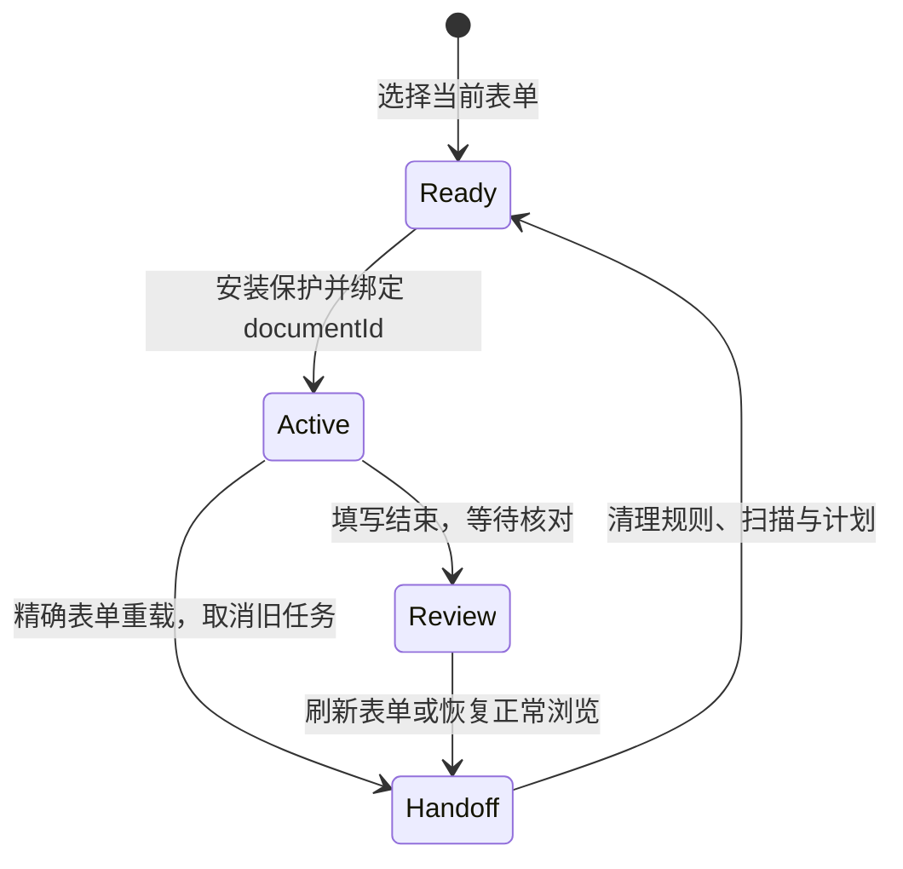

# 第九步：把任务、页面文档和网络规则的生命周期对齐

> 版本说明：本文保留该阶段的设计记录。0.7.9 已移除网页网络屏蔽、提交事件拦截与手动恢复步骤；当前操作边界见 [第二十二课](22-agent-actions-and-user-control.md)。控件适配与回读核验仍然保留。

日期：2026-10-05；版本：0.6.5。

## 1. 这次为什么又被屏蔽

用户刷新京东方表单后，Chrome 再次显示 `ERR_BLOCKED_BY_CLIENT`。面板同时保留上一轮的 18 个写入字段及网络保护状态。

代码表明，旧规则按 `tabId` 阻断请求，其中包含 `main_frame`。旧任务完成后仍保留该规则，刷新请求自然也会命中。上一轮修复了错误页上恢复按钮失效、面板丢失规则状态的问题，但没有解决“新文档仍受旧任务规则影响”。因此反复刷新会反复被屏蔽。

这属于 Agent 执行基础设施的问题。模型没有发出屏蔽指令；后台为防止页面副作用安装了规则，却没有完整处理页面重载的边界。

## 2. 同一个标签页、同一个网址，不一定是同一个页面

浏览器的 `tabId` 表示标签页，URL 表示地址。刷新之后，这两项可能都不变，但 DOM、脚本、事件处理器和控件引用都已经属于新文档。

因此“标签页和 URL 相同”不足以授权旧工具继续执行。Chrome 在脚本注入结果中提供 `documentId`，也允许按 `documentIds` 指定目标文档，详见 [Chrome scripting API](https://developer.chrome.com/docs/extensions/reference/api/scripting#type-InjectionResult)。

本版在安装页面保护时保存实际文档 ID。真实执行器的观察、写入、添加、最终复核都指向这个 ID。即使刷新后 URL 一字不变，旧文档不存在时也会停止，不能把旧字段计划套到新文档上。

它在整体架构中的位置是工具执行授权：LLM 仍负责选资料路径，执行器必须确认它操作的是当时观察到的页面。

## 3. 为什么不能只允许页面的 HTML 请求

网页重载还需要脚本、样式和图片。如果只允许 `main_frame`，其他资源仍被旧规则阻断，可能得到一个缺样式或无法交互的页面。也不能完全依赖后台收到加载通知后抢在所有子资源请求前删除规则。

本版增加一条范围明确的重载交接规则：

- 只针对本轮标签页。
- 只匹配已经选定表单的精确网络 URL，去掉不发送给服务器的片段部分。
- 只匹配 `GET` 的顶层文档请求；不放行 `POST`、其他路径、其他查询参数或 iframe 请求。
- 使用更高优先级的 `allowAllRequests`，让新文档及其子资源可以加载。

Chrome 对这种规则的优先级与框架内请求继承有明确说明，见 [declarativeNetRequest 规则匹配](https://developer.chrome.com/docs/extensions/reference/api/declarativeNetRequest#rule-evaluation)。原文档中的请求仍由执行保护阻断；精确表单重载进入新文档时，旧 Agent 会结束。

两条规则一并安装、核验和删除。核验包括请求方法、资源类型、精确地址条件与优先级；仅检查“有某个规则 ID”不能证明规则仍符合预期。

## 4. 如何停止旧任务和清理状态

后台监听本轮标签页的加载状态。收到 `loading` 时立即设置停止原因、使执行保护失效并关闭等待中的模型连接。较迟返回的模型建议不能触发新的写入。

随后等待正在结束的任务，删除旧网络规则、旧扫描和旧计划。这个过程不向刷新后的新文档注入清理代码，避免把新网页的事件或状态改掉。

清理还需要协调并发：刷新通知、任务的 `finally`、手工恢复可能同时到达。后台将同一轮清理串行处理，防止重复恢复与旧状态覆盖。关闭对应标签页也会清理；其他标签页的加载和标题变化不会解除本轮保护。

## 5. 刷新后的计数为什么还保留

执行记录属于历史任务，刷新并不改变过去确实发生过的动作。但这些计数不能表示新页面当前仍有同样内容。

面板因此显示“以上计数是刷新前的结果”，使旧映射和旧扫描失效，重新开放启动入口。未保存内容可能随网页刷新丢失；若需要继续检查或手工补齐当前内容，使用“恢复正常浏览”即可结束保护。

## 6. 如何验证这次修复

81 项 Node 测试覆盖精确 GET 重载、两条规则核验、相同 URL 的文档替换、模型等待时刷新、完成后刷新、关闭标签页、其他标签页不受影响，以及原有提交防护。

普通 Chrome 还进行了独立 UI 实测：模型等待期间刷新正常；旧任务取消并恢复启动入口。完整虚构填写完成后刷新正常。刷新后再次启动同一执行器，仍完成 23 个字段、7 次新增和整页回读。

为区分网页脚本保护和 Chrome 网络规则，还加入不含资料的延迟图片请求探针。保护开启时，图片与 POST 请求的本地服务计数均为 0；解除保护后人工输入虚构值，两项计数均增加，确认探针并非没有运行。测试后恢复用户原有资料并返回京东方表单。

这些验证说明本次页面重载和清理机制有效，不等于所有招聘网站的字段语义或后台行为都已经覆盖。保存草稿仍是独立能力，提交类动作仍不提供给 Agent。

代码位置：`agent-extension/src/network-guard.js`、`real-tab.js`、`worker.js`、`protection-recovery.js`。浏览器证据见 [本轮报告](../../reports/refresh-recovery-2026-10-05.md)。
