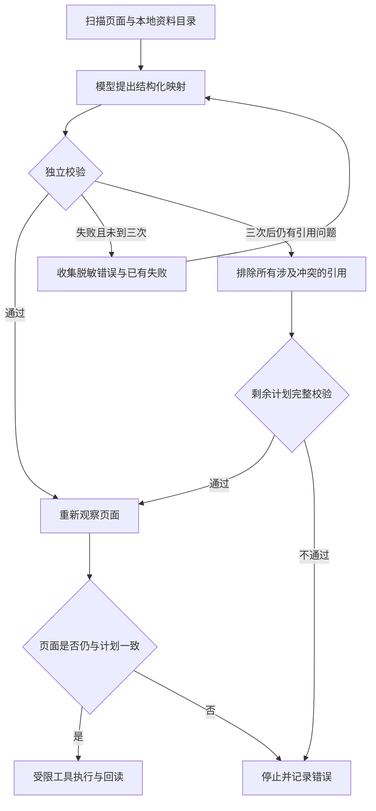

# 第十步：让 Agent 能修复计划，并保留可用的部分结果

日期：2026-10-05；版本：0.6.6。

## 1. 这一层在整体中做什么

当前真实表单路径分为五层：页面扫描、模型规划、程序校验、控件执行、回读复核。这次修改位于规划与执行之间。

模型提出“哪个网页字段应该取哪条资料”。程序检查这些引用是否存在、是否冲突、是否串了经历。校验通过后，执行器才在本地读取资料值并操作网页。



它使 Agent 有明确的错误恢复路径。三个模型调用是每轮规划的上限；新增记录以后会产生新的观察和新一轮规划。

## 2. 函数调用、JSON Schema 与运行时校验

函数调用允许模型返回结构化工具参数，例如下面的虚构建议：

```json
{"fieldId":"field-22","sourcePath":"languages.0.testScore"}
```

JSON Schema 描述允许的结构。本项目用 Zod 声明结构，再转成模型请求中的 JSON Schema。`strict()` 拒绝没有定义的属性，例如模型添加 `value` 或 `click`。

旧契约只要求引用是字符串。模型即使拼出不存在的路径，也符合“字符串”这个类型。本版将本轮允许的具体引用写成枚举。假设目录只有 `languages.0.testScore`，模型工具参数中就不会提供 `languages.0.testName` 这个选项。

模型服务对枚举的遵守程度仍需由实际输出确认。因此浏览器执行前的校验继续检查每条引用，不能把发送了 Schema 当作已经安全。

一个计划需要同时满足：

- 结构正确，引用存在，快照一致。
- 同一个网页字段只能有一个来源；同一个来源不能重复用于不同目标。
- 重复经历不能被分配到两个区块，也不能把第二段记录串填到第一张卡片。
- 声明、签名、凭据及文件上传不能进入自动执行。
- 冲突或未确认的资料不成为可用事实，已有内容继续保留。

## 3. 为什么重试要带着错误信息

“请再试一次”没有告诉模型哪里出了问题。之前只把最后一个错误交给下一次请求，也可能出现改好奖项以后又把英语成绩用了两次。

现在错误包含机器可读的种类，以及本轮已知字段、路径或记录前缀。例如 `source_in_multiple_fields` 说明同一来源同时被用于不同目标。模型还会收到本轮已确认的较早错误，以及同一建议中其他能定位的错误。

每次重试前重新观察页面。如果用户输入、切换标签页或刷新使观察变化，旧反馈和计划都停止使用。`snapshotId` 是观察元数据与公开资料目录的 SHA-256 指纹，不能作为真实填写内容正确的证明；它仅用于检测这些规划输入是否改变。

代码位置：`src/core/real-runner.js` 中的 `planFor`；模型适配器通过 `validationFeedback` 和 `previousFailures` 接收错误。

## 4. 局部失败为什么不能随便保留一个答案

这次页面同时有“英语等级成绩”和“其他语言能力及等级/分数”。模型把同一条英语成绩交给两个字段。程序没有证据确认模型原本想选哪一个，因此不能以出现顺序决定保留谁。

局部计划采用保守排除：

- 同一来源用于多个字段：涉及的映射全部删除，字段标为待人工核对。
- 同一网页字段出现多个来源：全部删除，不选一个来源获胜。
- 未知资料路径：删除该映射；未知原始文字不进入日志。
- 一类重复经历进入多个分组：排除这类经历的映射，不替模型选择分组。
- 记录顺序错误：排除该网页记录中同类经历的映射，不把索引改成另一个记录。

剩余计划重新运行原有完整校验；调用方再次独立校验后台提供的局部建议。该过程只删引用，不创造事实、不改变来源、不增加新的页面动作。其结果仍是计划，执行权限由后续工具层控制。

结构不合法、快照不一致、页面变化、网络保护无法确认等问题不会通过局部计划继续执行。

代码位置：`src/core/fill-plan.js` 的 `createPartialProposal` 与 `validatePartialProposal`。最初的严格 `buildFillPlan` 仍用于验证完整计划与局部计划。

## 5. 可观察性要帮助定位，也要控制记录内容

未知引用过去只留下 `PLAN_UNKNOWN_REFERENCE`，无法确定模型是编造了字段 ID，还是写错了资料路径。

现在区分 `unknown_field`、`unknown_source`、`unknown_group`、`unknown_section`。如果错误是“已知网页字段使用未知资料”，日志可以保留那个已观察的字段 ID。模型编造的原始字符串不写出，因为它可能包含无关文本或敏感内容。

后台日志增加时间、连接 ID、请求 ID、快照摘要和耗时。它们帮助分清不同运行及不同模型调用。执行面板显示网页字段标签，扫描诊断显示字段 ID；复制记录仍只包含元数据、代码与计数。

模型得到的错误摘要属于程序核验结果。面板不会展示模型逐字内部推理；会展示观察结果、规划尝试、排除的引用、实际工具动作和回读结果。

## 6. 怎样验证错误恢复

正常完成一次填写，无法证明恢复逻辑有效。需要主动制造可预期的故障，再检查结果。

本次回归使用虚构资料，让模型替身连续三次返回重复的语言成绩引用和未知路径。检查以下条件：前两次没有任何写入；第三次后只写入独立合法的手机号；两个语言字段和未知来源字段都留空；记录不包含虚构私有值。

另一个测试在第三次模型返回时模拟用户修改页面，确认局部计划也不能继续写入。WebSocket 往返测试覆盖后台产生拒绝和脱敏局部建议、扩展接收、调用方重新校验后仅执行其余合法字段。

86 项测试通过，京东方真实运行也通过了规划阶段，一次模型调用后最终回读保留 14 个字段。真实这轮未触发局部计划；局部计划的证据来自故障回归。两类证据的覆盖范围需要分别理解。

## 7. 还缺什么

合法引用与正确经历索引，只能证明计划满足这些程序条件。它们不能证明所有语义对应都正确。模型仍可能把标签相近但用途不同的资料对应到一起，回读一致也不代表招聘表单语义正确。

当前还缺复杂日期、地区级联、非原生新增控件等能力。下一步应针对真实失败补观察和适配器，并引入更细的语义验证与评测，而不是提高超时或让错误引用直接执行。

本轮脱敏浏览器结果与剩余错误见 [验证报告](../../reports/plan-repair-2026-10-05.md)。
