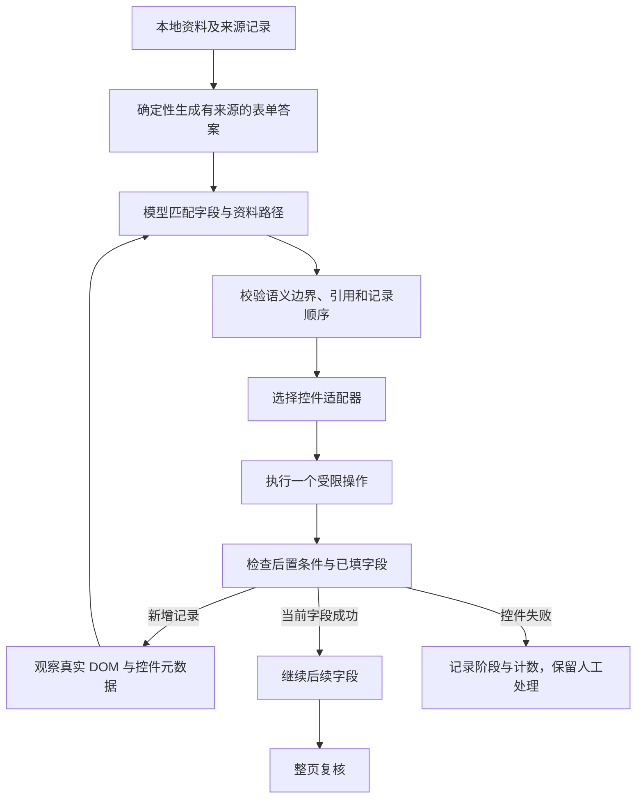

# 第十一步：让工具真正完成选择，并追踪填写结果是否保持

日期：2026-10-05；版本：0.6.7。

## 1. 这一步在 Agent 整体中处于什么位置

本轮处理真实网页的工具执行层，以及资料目录到网页答案之间的转换。模型已经能提出字段映射，执行器仍需要回答：这个控件怎样操作？怎样证明选中了？后面的操作有没有把之前的内容清空？



Browser Use 的流程包含页面观察、工具动作和后续状态检查。本轮落实其中的控件适配与结果验证。真实表单入口仍采用一轮 LLM 语义映射，再由受限工具逐项执行；新增记录后重新规划。日期面板内部的导航由程序完成，没有引入新的 LangGraph 调度器或通用点击权限。

## 2. 为什么“找到输入框”不能代表会填这个控件

真实页面里有不同的控件协议：

- 文本输入框需要更新网页组件接受的输入状态。
- 自定义下拉框需要打开选项面板、找到对应项、点击并检查选中显示。
- 月份日历需要读当前年份、导航到目标年份、选择月份，再检查主字段。
- 自定义单选需要定位选项容器，检查真实选中标记。
- 添加经历需要点击经过观察确认的添加控件，并观察记录数量恰好增加一组。

**控件适配器（control adapter）**把这些差异包在工具内部。模型决定字段应取哪条资料，适配器负责完成该控件的操作。模型不能提供任意脚本、选择器或点击坐标。

京东方的添加文字实际由“添加”和区块名称两段文本组成，位于同一个 `span` 中，外层为含 SVG 的普通 `div`。旧判断要求标签只有“添加”，因此漏掉了候选。本版识别观察确认的结构及区块，点击后仍要求卡片数增加一组。未经识别的普通容器、默认提交按钮以及“添加并提交”都不进入执行。

## 3. 日期精度与后置条件

京东方的经历日期使用月份日历，实际要求年/月。完整日期日历使用另一种适配路径。不能因为两者都被标记为“日期”就按同一种方式输入。

月份日历的步骤是：

1. 排除关闭后残留的空面板，找到本字段附近的有效面板。
2. 找到可见、文字为数字年份的标题。实测月份子面板中的一个“年份”标签不是数字年份，真正的年份在外层日历标题。
3. 点击经过确认的上年或下年按钮；每次检查年份恰好变化一年。
4. 在本面板中选择对应月份。
5. 回读主字段，要求显示的年/月与资料完全一致。

第五步是**后置条件（postcondition）**。按钮点过了、菜单关闭了、程序没有抛错，都不足以证明填写成功。

用户确认的补全规则已保存为本地偏好：只有经历日期缺少“日”，且目标确实需要完整日期时，才补成当月 1 日，并记录这次补全。出生日期不套用此规则。需要年/月的控件保持资料的年/月精度，日志注明目标精度；资料原文不改写。

## 4. 有来源的派生事实是什么

真实网站把同一条资料拆成多个问题，例如“在读学历”“本科院校”“毕业年份”“毕业月份”。重复经历又必须按记录顺序填写。直接把 `educations.0` 同时分给基本信息和教育经历，会破坏记录池的约束。

本版在本地资料层生成 `formAnswers`，每项都有 `derivedFrom` 和明确的转换类型。例如下面使用虚构资料：

```text
educations.0.endDate = 2028-06
educations.1.endDate = 2025-06

formAnswers.graduationYear  <- 最新教育记录的 endDate 的年份
formAnswers.graduationMonth <- 同一 endDate 的月份
```

模型只看到这些路径、标签及来源关系，资料值留在本地。当前教育记录由唯一的最近结束日期确定；若无法确定，会尝试唯一的最近开始日期；仍有歧义就不产生对应答案。本科院校要求唯一明确的本科或学士记录。英语等级和成绩仅从明确的四/六级考试格式中拆出。民族仅在资料明确写出族别时产生；“中国”不能变成“汉族”。

这叫**确定性转换与来源追踪（deterministic transformation and provenance）**。它帮助复用已经确认的资料，并让每个转换可以被审查。它不会让 LLM生成新的学历、成绩或日期。

## 5. 业务要求要由程序落实

本项目已有明确要求：只有获奖区块时，获奖和竞赛一起填写；存在独立的获奖与竞赛区块时，两类分别填写。

实测发现，模型即使看到两类资料，也可能只声明获奖部分。本版在区块关系明确时确定完整记录池。京东方页面的获奖区块因此需要 10 条记录，而不是只填 5 条。若区块有歧义，程序不会凭名称顺序强行选择。

原有重复引用与经历顺序校验继续保留。程序补齐缺失的业务路由前，先检查模型是否显式把同一类重复经历分配给多个区块。错误声明不能被自动整理后悄悄掩盖。

另两条语义边界也由程序检查：个人简介不能代替兴趣爱好，学校就业网渠道不能代替“其他渠道备注”。这些检查发生在读取资料值和执行写入之前。

## 6. 初次成功为什么还要继续复核

真实页曾在证件号初次回读一致后，将它清空。现在每次操作后检查此前本轮已成功填写的字段，记录第一次观察到变化的时点，并撤回成功计数。

日志说“操作某字段后，观察到证件号变化”，只表达时间关系；它不证明那个字段导致了变化。控件验证、组件状态更新等原因还需要进一步证据。

对于这类已尝试写入、后来为空的证件号，加入一次受限的浏览器原生编辑恢复。目标、标签和来源必须与原先尝试一致，当前值必须为空；用户后来输入的内容会被保留。恢复后失焦并等待，再回读及整页复核。恢复失败仍作为未完成，不能用重试次数代替成功证据。

最后一轮真实页的证件号写入通过了整页复核，没有再次触发丢失，因此这轮没有执行原生编辑恢复分支。恢复机制通过了合成组件状态变化测试；这与在真实页触发恢复成功属于两种不同证据，应分别记录。

## 7. 日志怎样帮助下一次定位

面板可以显示全部执行记录，以及逐项控件结果。诊断包含：

- `phase`：打开、搜索、导航、确认、精度处理或复核。
- `adapter`：具体的工具适配路径。
- `optionCount`、`panelCount`、`inputCount`、`yearSteps`：观察到的数量。
- `valueMatched`、`identityVerified`、`hasCurrentValue`：布尔回读结果。
- GET/POST 请求暂停计数：只记方法和次数，不记录 URL、请求参数或正文。

没有候选项的控件若同期请求了远程数据，日志能呈现这一事实。要确认哪个接口可读取，还需要接口层证据；本版没有据此开放任意网络请求。

100 项回归覆盖日期精度、月份日历、非原生添加、单选选中标记、获奖竞赛分流、语义拦截、状态变化、受限恢复和原有提交防护。本轮浏览器实测结果及尚未完成的字段见 [验证报告](../../reports/control-adapters-2026-10-05.md)。
