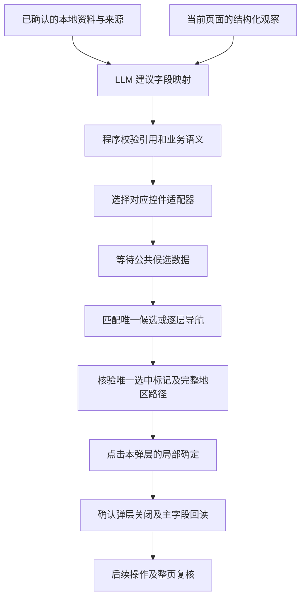

# 第十二步：把复杂选择器封装成可核验的 Agent 工具

> 版本说明：本文保留该阶段的设计记录。0.7.9 已移除网页网络屏蔽、提交事件拦截与手动恢复步骤；当前操作边界见 [第二十二课](22-agent-actions-and-user-control.md)。控件适配与回读核验仍然保留。

日期：2026-10-05；版本：0.6.8。

## 1. 本步在整体中的位置

本轮完善工具执行层。LLM 负责理解字段语义、选择资料路径；执行器负责按网页组件的真实协议操作，并提供成功或失败的证据。真实网页入口依然由普通 Chrome 扩展执行受限工具，Python Browser Use 入口用于虚构页面的 SDK 对照实验。当前没有引入 LangGraph。

## 2. 为什么简单输入没有完成选择

京东方页面的民族、籍贯主字段是 Phoenix 组件。点击后打开带搜索、候选列表、已选区域及局部取消/确定的弹层。输入文字只改变查询状态，不能代替候选选中及组件提交。

普通 Chrome 的人工核验确认了民族的 `RadioUnchecked → RadioChecked`，以及地区的 `area-icon-RadioUnchecked → area-icon-RadioChecked`。地区右侧通过 `.select-area-text-label` 显示已选路径。我们据此编写工具协议，而不是依据字段名称猜测点击目标。

工具要求：候选唯一、选中标记唯一、地区路径与明确来源一致、局部确定按钮唯一、主字段回读一致。只有这些条件成立才返回 `VERIFIED`。结束后还用原有 receipt 机制复核，防止后续组件更新清空已填内容。

这涉及 **DOM 观察、有限状态流程、前置条件、后置条件及持续回读验证**。适配器内部的短流程可以由确定性程序完成；每一次鼠标事件都不必交给 LLM 决策。LLM 的能力用于语义不确定性，程序约束用于可靠执行。

## 3. 词典读取与网络保护怎样配合

此前日志只证明操作期间发生了被暂停的 GET，不能证明该请求安全。随后通过 Chrome Network 界面确认了两个公共词典：民族枚举 JSON、地区静态资源。两者均观察到 GET 200；民族请求的跨域预检也返回 200，首次预检曾耗时约 18 秒。

新规则只匹配已核实的完整静态路径、选定标签页、京东方来源、GET/OPTIONS 和规定资源类型。民族地址仅额外允许纯数字时间戳，地区地址不允许附带查询参数。未知接口、带个人检索参数的地址和写入方法继续暂停。规则定义与安装结果必须一致，否则禁止执行。

Chrome 的 declarativeNetRequest 在浏览器层处理请求；页面 MAIN world 的 fetch/XHR 包装器在调用层执行同一约束。两层规则都需要开放已核实的公共读取，才能让网页正常获取候选。规则的优先级及匹配字段可查 [Chrome 官方 DNR 文档](https://developer.chrome.com/docs/extensions/reference/api/declarativeNetRequest)。

这一步涉及 **最小权限、精确允许规则、跨域预检、请求生命周期及浏览器执行世界隔离**。GET 方法本身不能证明一个接口没有写入副作用；必须先核实具体接口。本版没有允许模型动态添加网络目的地。

## 4. 地区精度为什么也要保留来源

导入资料的字段名不一定准确反映行政层级，也可能重复保存同一个地区。适配器按明确的来源值选择：相邻完全重复的地区合并，省级资料保留省级精度，明确的省/市/区路径逐层选择。不会为了填完网页而创造城市或区县。

`formAnswers.hometown` 保存 `derivedFrom`。地区值只从这些已有且已确认的本地路径取得，并传给页面执行器；模型看到路径及来源关系，执行记录只返回数量和布尔核验结果。

地区路径的核验防止同名城市或区县被选到错误的父级。找不到唯一候选时返回具体错误码，取消本弹层中的未提交选择。

## 5. 日志怎样定位失败

新诊断包含 `phase`、`adapter`、`optionCount`、`panelCount`、`levelCount`、`selectedCount`、`confirmCount`、`waitedMs`、`pathMatched`、`valueMatched`、`identityVerified`。民族/地区词典读取及成功/失败只记录次数，不记录请求内容、资料值或页面截图。

主要失败码包括 `DICTIONARY_NOT_LOADED`、`PICKER_AMBIGUOUS`、`REGION_LEVEL_UNAVAILABLE`、`REGION_PATH_MISMATCH`、`PICKER_SELECTION_NOT_OBSERVED`、`PICKER_CONFIRM_UNAVAILABLE` 和 `PICKER_NOT_COMMITTED`。执行记录会先说明最多等待 45 秒，再显示最终失败阶段，避免把网络等待误报为没有资料。

另一个生命周期修复是让页面保存下来的 fetch/XHR 包装器在解除保护后重新调用原方法。仅恢复全局属性不能恢复组件已经缓存的旧函数引用。合成测试验证了释放后的缓存引用可正常运行；它尚不能单独证明旧页面加载失败的具体根因。

## 6. 当前证据与下一步

107 项测试通过，扩展已构建为 0.6.8。新增用例覆盖延迟候选、局部确认、候选歧义、已有内容保护、重复省级来源、地区父子导航与路径不符、精确网络规则及缓存请求包装器的恢复。

人工控件核验和合成测试不等于 Agent 在真实页完成填写。换机后还需要重新安装扩展、导入资料、恢复本地服务，再执行普通 Chrome 的真实页面验收。届时应分别记录新写入、保留原内容、未完成及结束回读结果。
