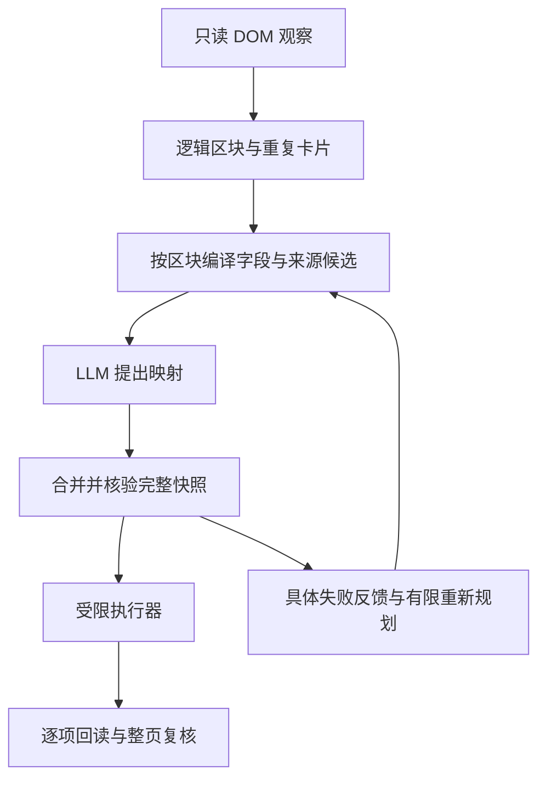

# 第十八课：从物理 DOM 到可验证的逻辑区块

## 为什么这一步属于 Agent 的观察层

之前程序将物理容器视作一种经历。真实网页可能用一个 `<form>` 容纳全部简历，也可能全部使用 `
`。观察模型得到错误的分组后，即使能够理解“学校”和“院校”同义，仍会把不同经历的卡片索引混在一起。

Agent 的状态表示必须表达任务中真正有意义的对象：逻辑区块、记录、字段和当前控件状态。这次修复改的是观察、规划、事实投影和核验之间的协议。

## 1. 逻辑区块与物理容器

一个物理容器可以包含多个标题及其后的字段。标题范围表示“从这个标题开始，到下一个区块标题为止”的观察对象。ARIA 的 `aria-labelledby`、`role=region` 与 `role=heading` 是网页提供的语义信息。显式标记和已观察的记录根继续有更高优先级。

重复卡片通过相邻 DOM 子树的结构、字段标签和控件类型识别。它不依赖记录值，也不依赖某公司的生成类名。标签缺失、重复模式不可靠等情况保留为不确定性，不能假装已经找到区块。

字段绑定包含原节点、标签、类型、逻辑区块和卡片根。写入前检查这些条件；节点被替换或移动到其他区块就停止该操作。这是把语义计划绑定到实际可观察对象的一步。

## 2. 分层规划与任务分解

全部字段放进一次提示词会使不同记录、摘要和日期互相干扰。现在先由程序观察区块，再让模型分别匹配每一区块，最后合并结果。

这是一种分层任务分解：外层处理区块与全局约束，内层理解字段同义关系与资料来源。模型仍承担语义判断；程序控制作用范围和验证条件。每个子规划沿用完整快照 ID，其他区块的标题和资料总数保留用于获奖/竞赛路由等全局需求。

分区意味着一次规划轮次可能包含多次底层 API 调用。界面显示“规划轮次”，进度记录每个区块的开始和结束。整个轮次共享配置的时间预算，不能把每个区块的等待时间无限叠加。

## 3. 结构化输出与来源约束

Function Calling 给模型一个可解析的函数参数契约。`fieldId` 和 `sourcePath` 分别指向真实观察和本地事实，模型不输出填写值。

模型可能返回语法合法、语义错误的来源。JSON Schema 中的候选枚举和 `anyOf` 分支有帮助，但不等于程序已经核验语义。现在还提供共享候选集合，字段通过 `sourceChoiceIds` 指向自己的合法来源，以免把别的字段的候选借过来。

随后程序独立检查：引用是否存在、日期单位是否相同、完整经历是否用了单条摘要、记录索引是否匹配、来源是否冲突、网页快照是否变化。只有合并校验通过后才可以执行。最多三轮失败反馈仍有明确上限。

## 4. 事实投影与来源追踪

同一日期在不同页面可能是完整日期、年月或年/月两个输入。程序从本地已确认日期生成 `startDateYear`、`startDateMonth` 等投影，保持原记录索引，并用 `derivedFrom` 指向原始日期。实际值仍在本地，模型只看路径和来源关系。

“最近公司”也是一种摘要投影。它与完整实习记录使用不同路径。结束时间全部不可用时才能根据完整的开始时间排序；日期只有月份时视为整月区间，区间重叠则无法唯一排序。没有依据就不给出该摘要。

投影的正确性还取决于用途。即使最近记录和第一张卡片碰巧是同一条，也不能把单条摘要当作全部经历。重复卡片必须使用各自的记录路径。

## 5. 可观察性与评测

“写入 8/11”隐藏了网页其实有 57 个字段。完整覆盖诊断必须显示所有观察对象，并区分标签缺失、资料缺失、映射歧义、未映射、保护、控件失败和后来回读丢失。

`formDiagnostic` 记录 ID、类型、分组依据、记录索引、日期单位、状态与来源路径，排除标签原文和资料值。可读事件显示程序的阶段和简短依据，供用户理解执行过程。

本轮评测分两层：生产执行器在三种虚构布局中写入、添加和回读；实际模型在同样布局和较大资料目录中只读规划。前者验证动作链，后者验证语义规划，二者均不能代替真实网站的验收。
