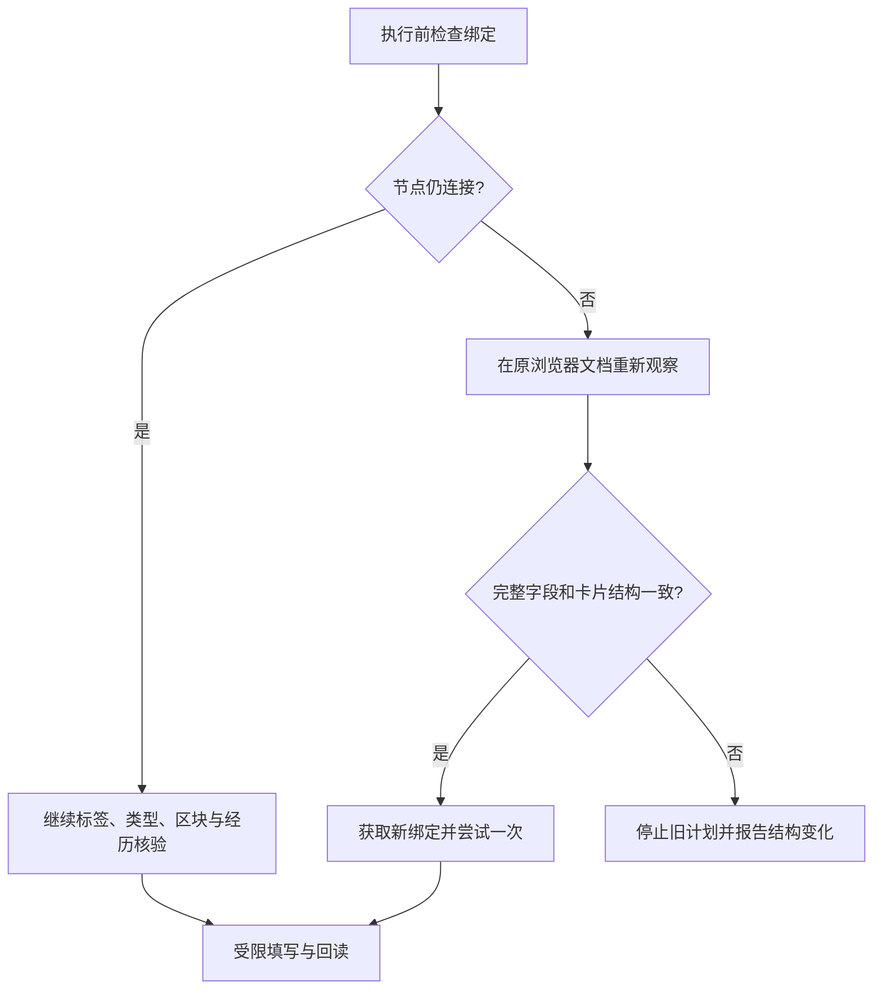

# 第二十课：动态页面中的节点替换与语义身份

## 这次日志说明了什么

0.7.6 的新记录在第 116 步失败：准备填写教育开始年份，`phase` 为 `open`，`connected` 为 `false`。这表示之前保存的节点已经脱离文档，尚未开始该年份的选择动作。

它与上次节点仍连接、只有日期标签变化的故障不同。我们能够确认旧绑定失效，但仅凭这一份日志不能断言具体哪段网站代码替换了节点。

## 1. 浏览器文档、DOM 节点和逻辑字段

这三个对象的寿命不同：

- 浏览器文档由 Chrome 的 `documentId` 标识。即使网址不变，刷新也会创建新文档。
- DOM 节点是当前文档里的具体对象，前端更新可以移除它并创建新对象。
- 逻辑字段是“教育经历第一条的开始年份”这样的任务对象。节点被替换时，它可能仍在同一个位置、具有同样含义。

保存一个 DOM 引用可以准确指向控件，但不能保证它在整个任务期间一直有效。因此执行器需要同时处理文档身份和字段身份。

## 2. 有界的重新观察

0.7.7 在写入前发现节点已断开时，先返回 `REAL_FIELD_BINDING_STALE`，不向旧节点输入。

浏览器环境继续验证当前标签页、网址、原 `documentId` 和请求保护，再重新扫描。只有整页语义结构与原计划一致时才重新绑定，最多尝试一次。

本次恢复不会直接按标签搜索一个相似输入框。它比较全部区块、字段顺序、经历索引、控件类型、日期用途、人工处理属性和按钮语义。存在变化时使用 `REAL_FORM_STRUCTURE_CHANGED` 停止。

字段值的存在性本来会随填写改变，因此不参与结构相等判断；资料值也不进入这份结构。

## 3. 回读记录如何保持有效

一个已写字段被替换，并不自动表示内容丢失。原先的 `WeakMap` 回执依附于旧节点，不能直接在新节点上找到。

现在只有在完整结构一致、逻辑字段相同、新控件当前显示值仍等于本轮已核验写入结果时，才把支持的回执关联到新节点。检查使用页面内存里的值，日志仅输出是否匹配。

如果值被用户修改或被网页清空，回执不会转移，成功计数需要撤回；执行器也不会因此获得覆盖用户值的权限。

相邻日期默认值的来源记录使用相同边界：同一日期问题、结构一致、值仍匹配、没有用户真实交互时才能继续完成。

## 4. 为什么恢复有上限

持续重建控件的网页可能每次都让绑定过期。无限重试会掩盖问题并产生重复操作。当前恢复每次只重新扫描并重试一次，实际导航和结构变化继续停止。

这种做法属于 Agent 的执行恢复机制：观察新的状态、判断旧计划是否仍适用、在条件满足时继续。此处结构未变，已有语义映射可以继续使用，因此无需为每次节点替换再次请求 LLM。

## 5. 如何验证

新虚构回归通过生产浏览器环境和执行器运行：

1. 写基础信息时替换尚未填写的教育控件，验证能恢复并完成日期。
2. 后续操作替换已经写入的字段，验证值未变时最终回读仍有效。
3. 替换节点并改变标题，验证不向新布局应用旧映射。
4. 替换节点并修改当前值，验证不会转移成功回执，也不会覆盖新值。

完整流程仍包含添加经历、年月联动、菜单关闭与不提交检查。0.7.7 阶段 169 项回归通过；后续 0.7.8 全量回归为 176 项通过。真实页面的结果与重绑机制的验收区别见 [节点刷新报告](../../reports/node-refresh-2026-10-06.md)。下一课讨论 [公共候选与界面完成状态](21-public-catalogs-and-committed-ui-state.md)。
