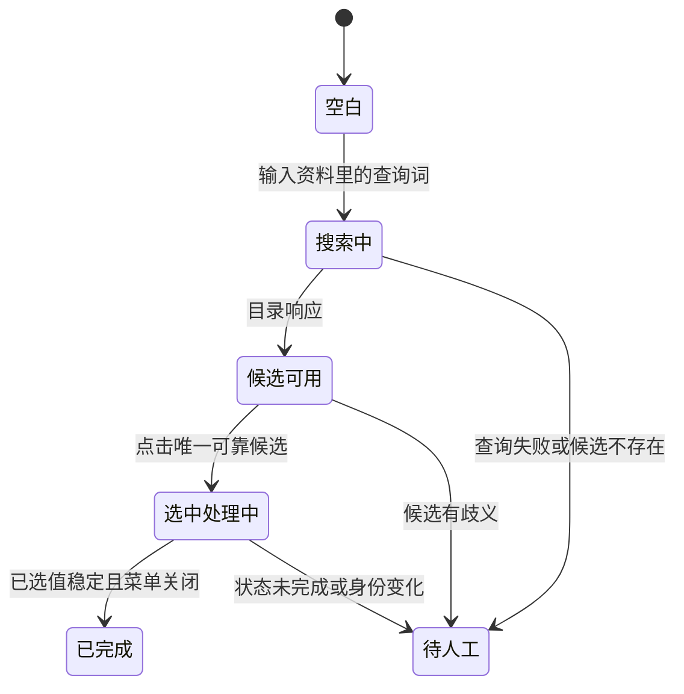

# 第二十一课：Agent 的公共查询能力与界面完成状态

> 版本说明：本文保留该阶段的设计记录。0.7.9 已移除网页网络屏蔽、提交事件拦截与手动恢复步骤；当前操作边界见 [第二十二课](22-agent-actions-and-user-control.md)。控件适配与回读核验仍然保留。

这一阶段处于“观察 → 规划 → 执行 → 核验”循环的执行与核验部分。LLM 已经能把学校和专业字段关联到资料路径，但浏览器还需要取得候选、点击选项，并确认网站接受了选择。

## 1. 一个搜索框包含几种状态

“输入框里有文字”只证明搜索词已输入。“点击了选项”只证明动作发生。要记录成功，需要观察独立的已选展示和收起状态。本项目以页面内回读生成回执，最终再次扫描确认结果仍在。

## 2. 为什么公共查询也会被拦住

自动填写期间，网页可能因为输入事件触发保存、统计、跳转或提交。我们使用 Chrome 的 `declarativeNetRequest` 与页面 MAIN 守卫限制请求，降低执行动作触发其他行为的风险。

学校目录查询是填写必须使用的只读能力。原保护层暂停了它，导致候选数为 0。正确的处理流程是先观察实际请求和返回内容，确认用途，再建立范围明确的能力定义：

- 当前标签页与发起域名。
- 固定学校或专业目录路径。
- GET 方法、固定参数名称与来源参数。
- 没有请求正文、URL 凭据、片段或额外参数。

能力定义属于经过审核的执行代码。LLM 只能在已有资料路径和页面字段之间提出映射，无法扩大请求范围。这种权限按能力划分的设计也适用于其他 Agent 工具。

## 3. 浏览器能力需要运行时验证

Chrome 为请求规则使用自己的正则引擎与内存限制。JavaScript 的 `RegExp` 测试通过，并不保证 Chrome 能编译同一规则。

本次真实错误是 `memoryLimitExceeded`，由 Chrome 的 `isRegexSupported` 返回。日志记录规则编号、目录类别和封闭原因，不输出包含查询词的请求地址。

修复后还要核查安装到 Chrome 的实际规则是否与预期一致。只有完成这一步，执行器才可以继续页面动作。这是工具执行前置条件的一个例子。

## 4. 等待完成条件，而不是猜一个固定时间

前端常在点击后异步更新已选值、销毁浮层或完成收起动画。固定等几十毫秒后立即检查，会把正常的过渡状态算成失败。

现在选择后循环读取状态，最多 2 秒，要求标签匹配、菜单关闭连续满足两次。日志输出等待时长和布尔结果。超时后仍明确报告未完成，不通过增加成功计数掩盖问题。

生产流程测试使用虚构控件：一个菜单延迟关闭，另一个始终不关闭。前者需要等待后成功，后者即使标签已经匹配，也不能取得成功回执。

## 5. 语义规划也要区分答案类型

语言的考试成绩、总体熟练程度、听说能力、读写能力，是四种不同事实。模型不能因为某个来源无法重复使用，就把考试成绩拿来填能力菜单。

这次增加两个独立资料字段，并在两处使用相同约束：

1. 构建模型工具的来源候选时过滤不兼容类型。
2. 执行前对模型建议独立校验，再次拒绝不兼容来源。

缺少分项资料就保留空白，等待用户填写或确认。Agent 的完整性还包括明确说明自己缺什么事实；不能把猜测写成用户资料。

## 6. 这一阶段学习到的技术

| 技术 | 在本项目中的位置 | 解决的问题 |
| --- | --- | --- |
| 受限工具能力 | 请求规则注册表与页面守卫 | 让必要只读查询通过，同时限制其他动作 |
| 浏览器 DNR 与规则核验 | 浏览器执行前置条件 | JavaScript 测试与实际 Chrome 能力差异 |
| 有界状态等待 | 下拉选择器的后置条件 | 异步界面尚未完成时的过早判断 |
| 回读与回执 | 执行核验及最终审计 | 区分尝试操作和已完成操作 |
| 来源语义约束 | 模型候选、独立计划校验 | 防止考试成绩与能力等级混用 |
| 虚构协议测试和真实验收 | 测试与修复报告 | 验证通用行为，并保留实际使用的证据 |

实现与验收范围见 [修复报告](../../reports/public-candidates-2026-10-06.md)。
