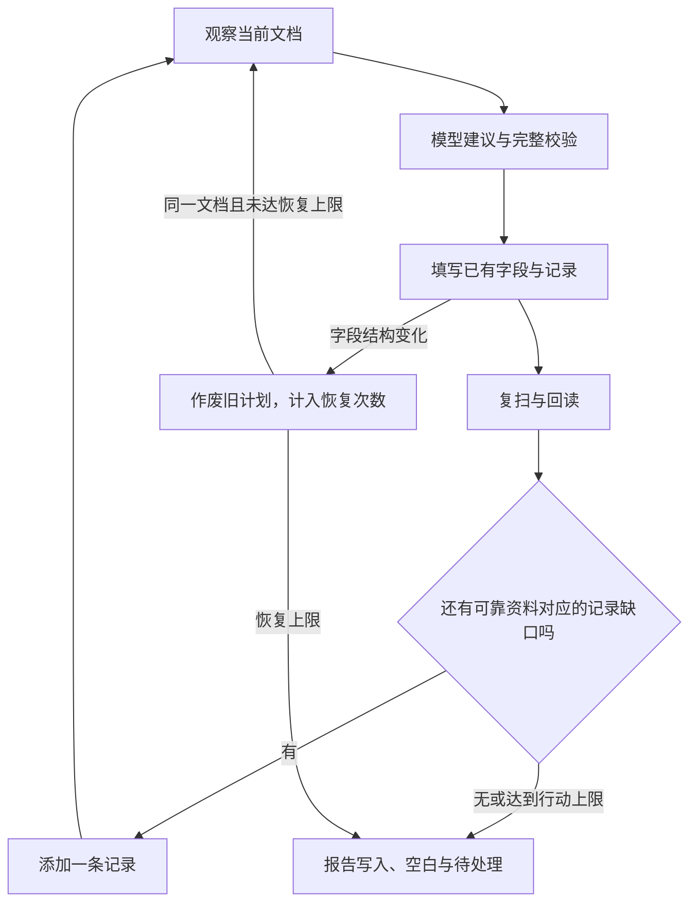

# 第二十四课：页面会变化，Agent 的计划也必须更新

## 这一步解决什么

真实复现出现了这样的流程：刚添加的空记录消失，获奖区暂时不见，第二次填写期间又出现。最初的固定流程“规划、一次性添加、再规划、填写”只能覆盖当时已知的区块。网页改变后，旧编号不能继续用，后出现的区块也会被遗漏。

现在执行器使用有界循环：

这属于 Agent 的执行、反馈与恢复层。模型提出映射，程序检查资料与动作，网页提供操作后的新状态；一次失败不等于必须让用户重新启动整个任务。

## 状态、计划与身份

DOM 节点是当前页面对象，字段编号是某次观察的编号。添加教育记录后，后面的获奖字段编号可能整体后移。两者都不能作为跨观察的唯一身份。

本项目用分组标题、记录索引、字段标签、控件类型、日期单位与方向、读写限制等组成语义身份。只有前后观察中的对应关系唯一，审计引用才会更新。新布局仍需一份新计划；更新审计引用不授予继续执行旧计划的权限。

## 保留哪些记忆

填完一条教育经历后，模型可能只收到剩余空字段，因而不再声明教育分组。可资料库还有第二条教育经历。执行器保留本轮已经验证过的分组关系，在标题唯一、来源和第一条记录的结构保持时，将这个分组声明补入新建议。

这不是保存旧字段映射。新字段仍要观察、匹配来源并完整校验。资料中的重复记录池决定缺口，网页当前数量决定是否需要添加。

## 为什么恢复有上限

预期的添加记录不消耗结构恢复次数。网页自行移除、重建或改换字段时，最多执行 3 次重新规划。文档导航与模型等待期间可观察到的输入存在状态变化继续停止。敏感字段的存在状态不进入模型时，由执行器检查并保护已有内容。这样既能处理初始化与条件字段，也不会在持续变化的页面中无限执行。

## 快照要描述什么

0.7.15 的真实首轮仍然失败：重新规划期间一个没有字段的分组消失，字段保持 62 个，却触发了快照过期。这表明快照同时需要考虑两件事：足够完整地描述会影响动作的输入，又避免把无关界面变化当作任务变化。

0.7.16 的规划快照保留两类分组：有填写字段的分组，以及具有已观察到的添加经历入口的空分组。关闭普通提示或没有字段的临时容器，不改变这份规划输入。字段标签、记录索引、控件限制和可观察到的内容存在状态仍参与快照，发生变化后原计划继续失效。

空经历区块不能因为“没有可填写字段”就被判为人工事项。它可以规划第一条经历，添加后重新观察字段。空声明区块仍然属于人工操作；添加按钮的语义与记录数量变化由执行器独立检查。这些边界由当前页面结构决定，没有按公司网址写例外。

## 成功证据

每次写入后回读；后续操作后检查之前的写入；新观察中对应目标失去身份或值不再保持时撤回计数。现有内容与资料一致，仍不等于由本轮 Agent 写入。

报告需要分别展示新增写入、未添加记录、空字段、缺少可靠映射、结构恢复和人工事项。虚构验证能证明执行机制，刷新后的真实第一次运行才能证明这次问题的实际改善。

0.7.16 的两个独立刷新首轮都完成了最终复核，各保持 64 个新增字段、添加 12 条记录，并在同一轮恢复了 1 次结构变化。这个结果支持“首轮可以在变化后继续完成执行”的结论；各自仍有 31 个空字段和 2 个待核验目标，因此不能把生命周期问题的改善等同于整页填写正确。

真实证据见 `reports/cold-first-run-2026-10-06.md`。
