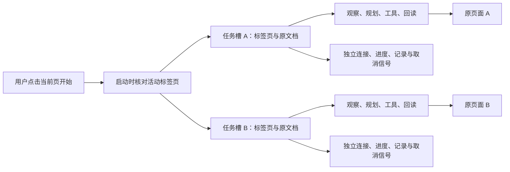

# 第二十五课：把一个 Agent 变成多个互不干扰的标签页任务

## 为什么需要这一步

之前的后台只有一个全局状态、一个模型连接引用和一个停止标志。每次执行还检查当前显示的标签页。于是切页会被误认为原页面发生变化；A 运行时，B 也不能开始。

这一步属于 Agent 的任务调度与浏览器执行层。字段理解、资料检索、规划校验、受限工具和最终回读继续由原有模块完成。调度器负责回答：这个回调属于哪个任务，应该操作哪个页面，谁能停止它。

## 三种身份要分清

| 身份 | 用途 | 为什么不能互相替代 |
| --- | --- | --- |
| `tabId` | Chrome 标签页、任务槽、面板结果的归属 | 同一个网址可以打开两页；网址不能作为唯一任务键 |
| `documentId` | 启动时绑定的网页文档 | 刷新后标签页和网址可以都不变，但原文档已销毁 |
| `runId` | 一次执行与服务端诊断的关联 | 同一页可运行多次，需要区分每轮的日志 |

页面内部的字段编号和语义身份仍是另一层：它们解决同一个文档里的动态字段变化，不能替代浏览器文档身份。

## 每个任务拥有自己的状态

实现使用 `Map<tabId, task>`。执行函数、模型进度回调、结果发布函数都显式接收 `task`，不使用可随用户切页而改变的全局“当前任务”。每个任务有独立 WebSocket，关闭 A 的连接不会拒绝 B 正在等待的模型响应。

JavaScript 在同一个 service worker 中调度这些异步任务，并不意味着为每页建立一个系统线程。网络、模型等待与工具请求可以交错进行。关键是等待恢复后，回调仍持有原任务的引用。

## 互斥需要按资源决定范围

同一页不能同时扫描、生成计划和填写，因为字段可能变化，状态也会互相覆盖。不同页的页面资源不同，可以各自运行。

资料库和日期规则属于共享资源。任一任务运行时，保存、导入或修改规则暂缓；每轮使用启动时取得的本地资料。这保证 A 和 B 不会在执行到一半时换成另一个资料版本。面板显示其他任务数，但开始与停止按钮只作用于本页。

这就是并发系统里的资源隔离：每个资源决定自己的锁范围。把所有动作都锁在一个全局标志下，无法同时使用多页；没有共享资料约束，又会产生版本变化。

## 在后台运行还遇到了什么

第一版改掉标签页检查后，真实 Chrome 中两个任务确实同时继续。但下拉选择的短等待明显变慢，出现 `OPTION_NOT_COMMITTED`。原代码用网页 `setTimeout` 等待菜单关闭，再要求连续两次回读稳定。隐藏页面的计时器可能被 Chrome 限速；等待被拉长时，按墙钟时间计算的核验窗口可能在第一次观察后就结束。[Chrome 官方计时器说明](https://developer.chrome.com/blog/timer-throttling-in-chrome-88/)

0.7.18 把 Agent 的短等待移到扩展后台：隔离脚本只发送等待毫秒数；后台通过 Chrome 提供的发送者信息核对标签页与文档，时间到了才回复。网页没有得到通用调用后台功能的入口，等待消息不携带字段值。[内容脚本与扩展通信](https://developer.chrome.com/docs/extensions/develop/concepts/content-scripts)、[MessageSender](https://developer.chrome.com/docs/extensions/reference/api/runtime#type-MessageSender)

消息的等待范围是 1–1000 ms。只有本扩展、主文档、绑定的 `documentId`、原网址、仍在运行的任务可以请求。取消任务立即拒绝它自己的待完成等待；其他页的等待继续。这没有更改浏览器设置、网页的计时器 API、可见性或提交按钮。

这个方法控制的是 Agent 自己的等待。网站若依赖只在前台发生的渲染、浏览器冻结页面、关闭浏览器或系统休眠，仍可能停止进展；不能因此重放已失效的计划。

## 会话持久化与重启

每页状态写到 `agentTabTask:<tabId>`，包括本页计划、扫描报告、进度和不含资料值的执行记录。运行时连接、DOM 引用、取消信号与计时器不持久化。

后台意外重新启动时，上一轮标为运行中的任务会显示中断；已经结束的任务保留结果；已经关闭的标签页会清理记录。旧版单任务格式自动迁移。恢复记录不等于恢复执行，自动重放旧计划可能把工具写到新文档，所以必须重新由用户启动。

## 如何验证这类改变

生产 worker 的虚构测试刻意让两个相同网址的标签页同时等待模型，反转响应顺序，切到第三页，再分别返回结果。另有停止、刷新、关闭和迟到响应测试，检查原任务取消后不会写进替换文档，另一个任务保持自己的连接、进度和结果。

真实验收用普通 Chrome、已有资料和模型配置；每页刷新后只点正常开始按钮。两页同时运行后切到第三页，等待最终回读。不能用“两个开始按钮能点”代替后台完成证据，也不能把后台执行成功等同于全部字段正确。实测记录与仍未通过的检查见 [本轮报告](../../reports/background-tabs-2026-10-06.md)。
